# Symmetry
Strike a pool ball with a cue, and the balls move in an expected way. Move the table over a few feet, and the balls move in recognizably the same way. Wait a few minutes, and the balls move in the same way. Turn the pool table a few degrees, and the balls still move the same way. Put the pool table on a train at constant velocity, and, again, the balls move in the same way. These are the manifest "symmetries" of the world we live in — position and time translation, rotation, and velocity "boosts."

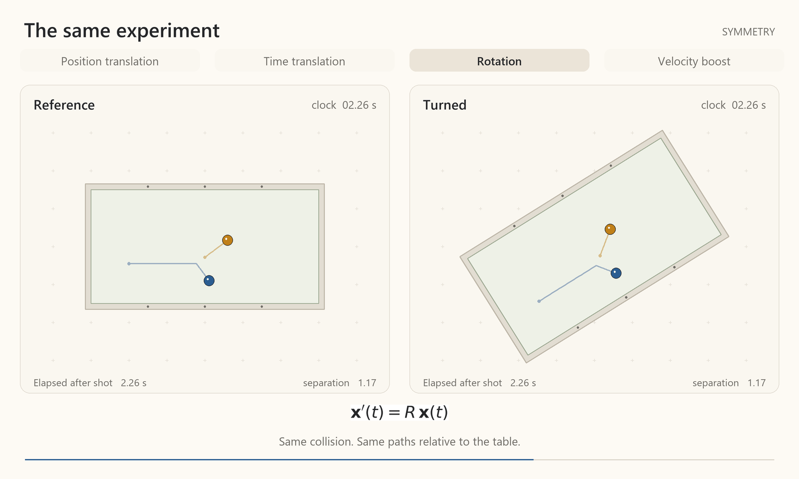

[Open MP4: symmetry-pool-table.mp4](animations/symmetry-pool-table.mp4)

*Symmetry transforms don't change how pool balls behave*

These changes in the orientation or location of the pool table are equally well expressed as changes in the orientation or location of the observer. As such, we can call them changes to the **reference frame**.  The sense in which the behavior of our pool balls is the same in different reference frames is intuitively obvious, but going forward, we will work with a more specific definition. While observers in different frames record different coordinates for balls’ paths, they agree on the **equations of motion** that specify the rates of change used to calculate those paths. Thus when we say a change of reference is a symmetry, we specifically mean that the equations of motion are preserved under such a change. 

In addition to these symmetries of **evolution**, we will see that if that evolution is to fulfill the principle of information preservation, it must preserve an additional symmetry structure carried by the space of instantaneous states. This structure will be reflected in the form of the equations of motion.

That physical behavior is unchanged under shifts in the frame of reference may well be an interesting observation, but why should we start our story here? We will argue that symmetry constrains both the laws that govern physical evolution and the classification of the objects that undergo that evolution. The term "symmetry" in this context may not at first glance seem like the same concept as, say, a triangle's symmetry, but it precisely is.

We will start with the familiar world of "discrete symmetries" and build up the definitions we need from there. Then we will turn to “continuous symmetries,” specifically rotations and translations, where we will encounter a new branch of math, Lie algebra, that joins the study of symmetry with calculus. We will discover that waves arise naturally as state objects when we represent translational symmetry, and this will lead us to a discussion of Fourier analysis, the structure of the space of wave functions, and how that structure shapes their equations of motion.

Let’s start, then, with the humble triangle.

## Discrete Symmetries
Consider a triangle:

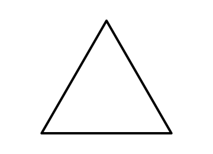

*An equilateral triangle*

We can see its obvious symmetry. To categorize its symmetry we can write down all the actions that leave it unchanged:
1. Do nothing
2. Rotate 120°
3. Rotate 240°
4. Flip along an axis
5. Flip then rotate 120°
6. Flip then rotate 240°

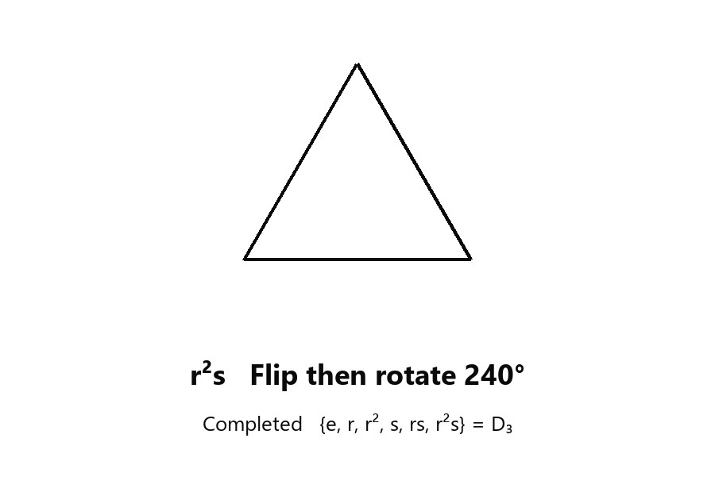

[Open MP4: symmetry-triangle-actions.mp4](animations/symmetry-triangle-actions.mp4)

*A triangle's symmetries*

We say the triangle "belongs to the $D_3$ symmetry **group**." Any number of objects possess $D_3$ symmetry.

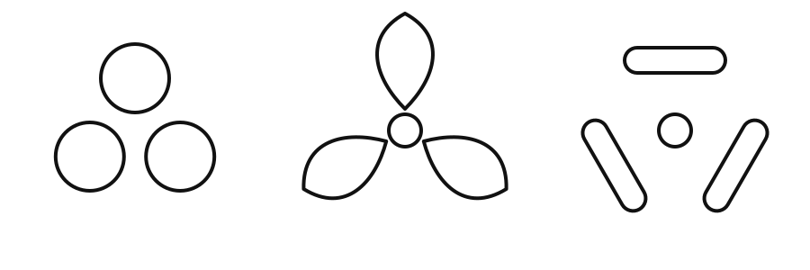

*$D_3$ is more general than triangles*

We tend to think of a "triangle's symmetry" not the "symmetry of two rotations and flips about 3 axes," but this latter way of thinking in terms of symmetry groups is more general and is the sense we use in physics, where we ask not "what symmetry does this or that object have?" but "what mathematical objects realize the actions of this symmetry group?"


### Representations
We can plainly "see" the symmetry of the triangle, but what if we want to write it down mathematically? Specifically, can we write group actions in terms of how they transform labels on an object? For example, suppose we label our triangle's vertices \(A, B, C\) and ask, if we rotate twice, flip once, then rotate again, where is vertex \(A\) sent? Recognizing that the triangle's state has three ordered components, we might guess that we could represent the triangle as a vector with 3 components. We could then represent these actions as transformations of the vector that permute its components in the same way that the symmetry actions permute the triangle’s vertices.

There is nothing special about the vertices here. We could just as easily have chosen the midpoints of the edges or any other triplet of points with the triangle's symmetries, and the same matrix that permutes the vertices would permute those vectors. That is, the group actions are represented by some set of **linear** transformations. A **representation** of a symmetry group is such a vector space and set of linear transformations that compose in the same way as the group actions:

$$
D(g_1g_2)=D(g_1)D(g_2),
$$

where $g_1$ and $g_2$ are group actions, such as a rotation and a flip, and $D(g_n)$ is the matrix representing the $g_n$ action, and $D$ itself is the map from symmetry actions to matrices in the representation. This says that the matrix for the composed action ($g_2$ followed by $g_1$) is the product of the matrices for the separate actions.

To construct a 3-dimensional representation of $D_3$, we map the 3 vertices to components of a vector.

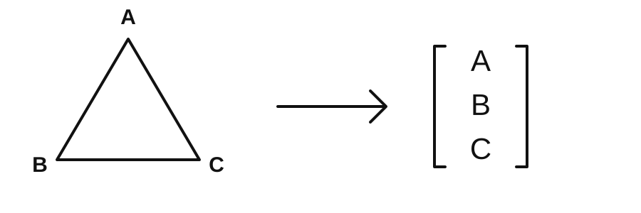

*Each triangle vertex supplies one component of the vector*

We can represent rotations and flips, respectively, with the following matrices:

Rotation:
$$
\begin{pmatrix}
0 & 0 & 1\\
1 & 0 & 0\\
0 & 1 & 0
\end{pmatrix}
$$

Flip:
$$
\begin{pmatrix}
1 & 0 & 0\\
0 & 0 & 1\\
0 & 1 & 0
\end{pmatrix}
$$

For example, a single rotation would be represented as

$$
\begin{pmatrix}
0 & 0 & 1\\
1 & 0 & 0\\
0 & 1 & 0
\end{pmatrix}
\begin{pmatrix}
1\\
3\\
5
\end{pmatrix}
=
\begin{pmatrix}
5\\
1\\
3
\end{pmatrix}.
$$

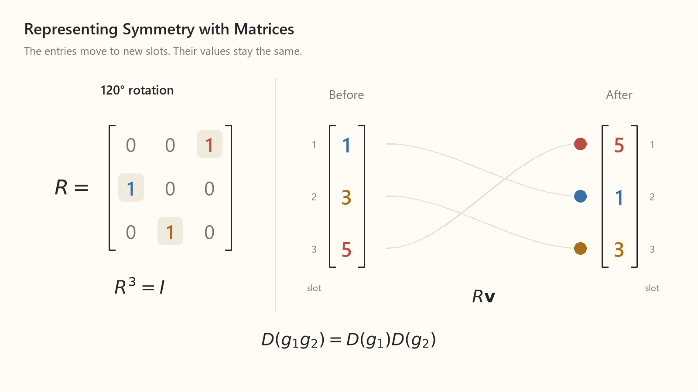

[Open MP4: symmetry-d3-transformation-matrices.mp4](animations/symmetry-d3-transformation-matrices.mp4)

*Three rotations or two flips return the vector to its starting state*

A set of matrices whose products give every transformation in the symmetry group forms a set of **generators**. For example, in the 3-dimensional representation of $D_3$, all transformations can be constructed from one rotation matrix and one flip matrix. 

#### Irreducible Representations
Visually, permutations that correspond to rotations of the triangle are 120-degree rotations about a diagonal axis in this vector space, while those that correspond to flips are reflections in three planes that contain the diagonal axis. This is much easier to see than to say.

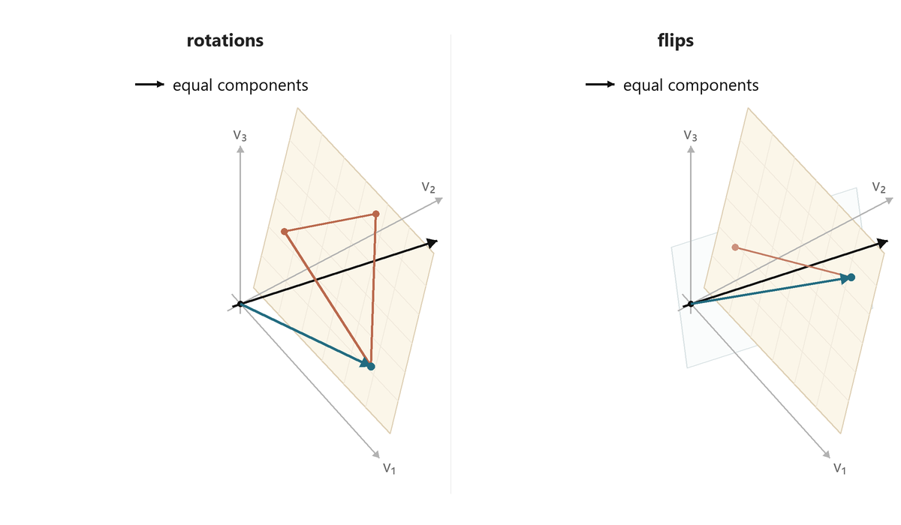

[Open MP4: symmetry-d3-rotations-vs-flips.mp4](animations/symmetry-d3-rotations-vs-flips.mp4)

*$D_3$ in 3-dimensional representation*

Now, we might notice something about these visualizations. The transformation of any vector lies in a plane, and all such planes are parallel to one another. Thus, if we subtract the average of a vector's components from each component, that is, if we move the point where the plane intersects the axis of rotation to the origin, we preserve the permutation structure of the transformations. We thus see that the $D_3$ symmetry is just as well represented as 120-degree rotations and reflections in the subspace of a 2-dimensional plane.

For our earlier example vector, the average of the components is 3. We can decompose the vector into one vector whose components are all the average value and one whose components add to zero.

```math
\begin{pmatrix}1\\3\\5\end{pmatrix}
=
\begin{pmatrix}3\\3\\3\end{pmatrix}
+
\begin{pmatrix}-2\\0\\2\end{pmatrix}.
```

The common part lies on the rotation axis itself and is unchanged by every permutation. The zero-sum part lies in a plane through the origin. Although written with three components, it needs only two independent numbers since the third is constrained by the sum being zero.

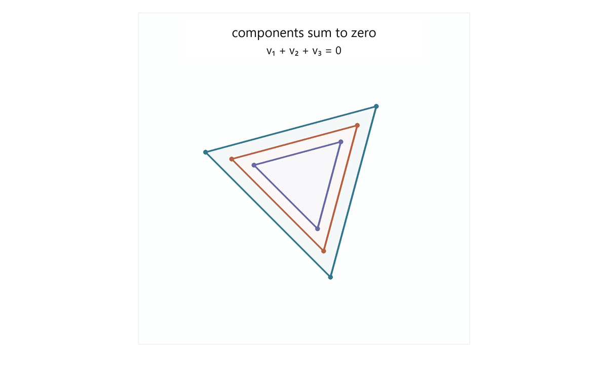

[Open MP4: symmetry-d3-irrep-collapse.mp4](animations/symmetry-d3-irrep-collapse.mp4)

*Reducing 3-dimensional representation to 2-dimensional*

We also notice that vectors that lie on the axis of rotation itself are left unchanged by the transformation. A way to think of this is to allow the triangle's vertices to store some information, like a number. If the value they store is the same for all vertices, the symmetry actions have no effect, whereas if they are different, the actions permute those values in a way that can be represented in a 2-dimensional vector space. The 3-dimensional representation space we began with is thus decomposable into 2 subspaces, one 1-dimensional, the other 2-dimensional. These cannot be decomposed further. That is, neither subspace contains a smaller nonzero subspace preserved by every group transformation. The 1-dimensional and 2-dimensional representations are called **irreducible representations** or **irreps** for short. This is admittedly heavy math. Why bother? In the story we have to tell of quantum physics, the state of the fundamental constituents of matter, **particles** such as electrons or photons, must transform under the symmetries of evolution. Each particle type corresponds to an irreducible representation of this symmetry. 

### Invariants
Once we have chosen a representation for a symmetry, we might well ask, how do we know our transformations preserve the symmetry? If we look at a triangle and rotate by 100 degrees we can "see" that doesn't preserve the symmetry. In a representation, we need some set of mathematical expressions that say "this transformation left the triangle the same." We call these the **invariants** of the transformation. 

In our 2-dimensional irrep of $D_3$, we only need to check how a transformation acts on an arbitrary vector. The question "does the triangle overlay itself" becomes "is an arbitrary vector rotated by 120 degrees or flipped along a given axis." And this has a precise answer. Given the coordinates of a vector a transformation cannot change these invariants:

```math
r^2=x^2+y^2
\qquad\text{(the squared length of the vector),}
```

```math
u=x^3-3xy^2=r^3\cos(3\theta)
\qquad\text{(its orientation relative to reference).}
```

The first invariant allows every rotation and reflection in the plane. To see what the second adds, notice that $\cos(3\theta)$ has its maxima along three rays spaced $120^\circ$ apart. The rotations and reflections that preserve those three rays as a set are exactly the six symmetries of the triangle. 

#### Invariants in Physics
The equations of motion of a system are, by definition, an invariant of the unified **spacetime** geometry in which systems evolve. That is, we defined these symmetries as those transformations under which the laws do not change. Generalizing the idea of a path of a single body to a **history** of a system, we can express what it means for $g$ to be a symmetry of the laws of motion in a compact schematic equation. Here $\Phi$ is a history and $\mathcal E$ encodes the equations of motion:

```math
\mathcal E[\Phi]=0
\quad\Longrightarrow\quad
\mathcal E[g\Phi]=0
\qquad\text{for every }g\in G.
```

To make this concrete, let's work through a quick example. Let the equation of motion be $\ddot x+x=0$ and the history be $\Phi(t)=\cos t$:

```math
\mathcal E[\Phi](t)
=
\frac{d^2}{dt^2}\cos t+\cos t
=
-\cos t+\cos t
=
0.
```

Translate the history by a time $t_0$:

```math
(g\Phi)(t)=\Phi(t-t_0)=\cos(t-t_0).
```

Then

```math
\mathcal E[g\Phi](t)
=
\frac{d^2}{dt^2}\cos(t-t_0)+\cos(t-t_0)
=
-\cos(t-t_0)+\cos(t-t_0)
=
0.
```

But the equations of motion are not the only invariant of spacetime symmetry. As we would imagine, there are much simpler invariants, akin to distance between objects, that will define the allowable transformations of spacetime symmetry. 

Later, we will discuss the idea that varying a functional of possible paths an object could travel can be used to single out the physically valid path. In the context of complex systems or **fields** we generalize the idea of a path to a **history**. We can vary a functional of this history and find a stationary point, that is a history near which the functional changes only in higher powers of the variation. Such a history will satisfy the equations of motion. Since the equations of motion that describe the history are invariants of the symmetry, might the functional itself be invariant? This functional is called the **action**. Under the full symmetry of spacetime, it is invariant up to terms that do not affect which histories are stationary. We might guess further that if the functional is an invariant, it is constructed by using the simple invariants, like those akin to distance between points. This is also generally the case. Thus we see a roadmap emerge provided by symmetry. Symmetry leads us to simple invariants, those invariants are arranged to construct an invariant functional, and finding the stationary points of that functional leads to equations of motion, which are themselves invariants of the symmetry.


#### Invariants and Groups
A group is defined by formal properties.

- **Closure**: combining actions stays within the group
- **Associativity**: regrouping a sequence without reordering it leaves the result unchanged
- **Identity**: there is a do-nothing action
- **Inverses**: every action can be undone

Here we see a deep mathematical connection. Any group of actions that fulfill these properties is a "symmetry" in the intuitive sense that they preserve an invariant. Let the group act on its own elements by composition (written for the general case as multiplication). Now start with two elements $a,b$ and their "relative difference" $a^{-1}b$. Applying $g$ changes them to $ga,gb$, but leaves that relationship unchanged:

```math
\underbrace{(ga)^{-1}(gb)}_{\text{after}}
=a^{-1}g^{-1}gb
=\underbrace{a^{-1}b}_{\text{before}}.
```

We can see how this works for real numbers under addition: inverses are negatives, so the original difference is $-a+b=b-a$. Adding $g$ to both positions preserves it:

```math
\underbrace{(g+b)-(g+a)}_{\text{difference after}}
=\underbrace{b-a}_{\text{difference before}}.
```

The positions change, but their separation is invariant. Addition acts as a translation of the number line.

## Continuous Symmetries
What rotations return a circle to itself? All of them! Similarly, all translations return a line to itself. The symmetries of space and time are continuous and can therefore be represented as transformations that depend on continuously varying parameters. 

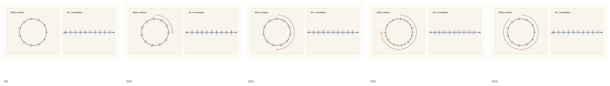

[Open MP4: symmetry-continuous-so2-translation.mp4](animations/symmetry-continuous-so2-translation.mp4)

*Continuous symmetries*

### Infinitesimal Generators
As we saw, in the $D_3$ symmetry group, we can build any action from a combination of the elemental actions of rotations and flips about an axis. Now let us ask the question, what is the generator of a continuous transformation? Let's say we want to rotate a circle by 10°. We could compose 10 1° rotations. But what if we want to rotate by 1°? We can see where this is going. The generators must be infinitesimal rotations. Noting that if we zoom in enough, any curved surface appears flat, we see that a continuous symmetry's infinitesimal generators are basis vectors in the tangent plane to the symmetry's action. 

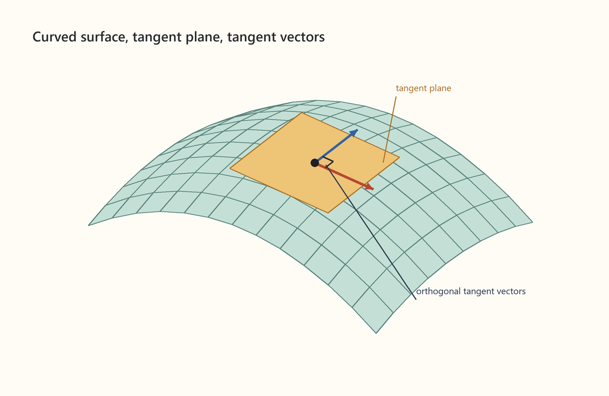

*Infinitesimal generators are vectors in the plane tangent to the space of symmetry transformations*

In the case of a circle, in the 2-dimensional representation, we have a single variable that parameterizes the operator matrix:

```math
R(\theta)
=
\begin{pmatrix}
\cos\theta & -\sin\theta\\
\sin\theta & \cos\theta
\end{pmatrix}.
```

As every high school calculus student learns, a derivative of a function is the slope of the tangent line to that function. We can take the derivative of the matrix valued function of $\theta$. This is

```math
\frac{dR}{d\theta}
=
\begin{pmatrix}
-\sin\theta & -\cos\theta\\
\cos\theta & -\sin\theta
\end{pmatrix}.
```

To obtain a single matrix representing this infinitesimal nudge, we evaluate the derivative at $\theta=0$, where $R(0)=I$ is the identity transformation. In that case,

```math
\left.\frac{dR}{d\theta}\right|_{\theta=0}
=
\begin{pmatrix}
-\sin 0 & -\cos 0\\
\cos 0 & -\sin 0
\end{pmatrix}
=
\begin{pmatrix}
0 & -1\\
1 & 0
\end{pmatrix}.
```

This is the infinitesimal generator matrix:

```math
\hat J
=
\begin{pmatrix}
0 & -1\\
1 & 0
\end{pmatrix}.
```

Now apply this tangential nudge to a state vector

```math
\mathbf v(\theta)
=
\begin{pmatrix}
x(\theta)\\
y(\theta)
\end{pmatrix}.
```

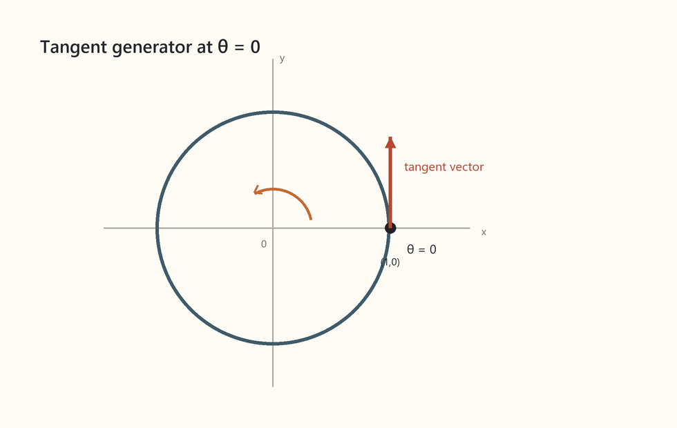

*The generator matrix \(\hat J\) acts on the point \((1,0)\) to produce the tangent vector \((0,1)\) shown here.*

$\hat J$ acts on any point on the circle to produce the tangent vector at that point. Putting this into differential notation,

```math
\frac{d\mathbf v}{d\theta}
=
\hat J\mathbf v.
```

We now have a differential equation for the transformation that uses the generator. We found this by starting with a known transformation and deducing its generator. But we can just as well go in the opposite direction. Given this differential equation, we can find the transformation:

```math
\mathbf v(\theta)
=
e^{\theta \hat J}\mathbf v(0).
```

The exponential of a matrix is defined in terms of the Taylor expansion for an exponential:

```math
e^{\theta \hat J}
=
I
+
\theta \hat J
+
\frac{\theta^2}{2!}\hat J^2
+
\frac{\theta^3}{3!}\hat J^3
+
\cdots .
```

This is an **exponential map**. It takes the infinitesimal generator $\hat J$ and returns the finite symmetry transformation $R(\theta)$. We tend to think of exponentiation as purely algebraic, yet here it connects a tangent vector to a finite symmetry transformation.

#### Flows under Symmetry Transformations

We can think of a symmetry transformation as a "uniform looking" vector field, as illustrated below:

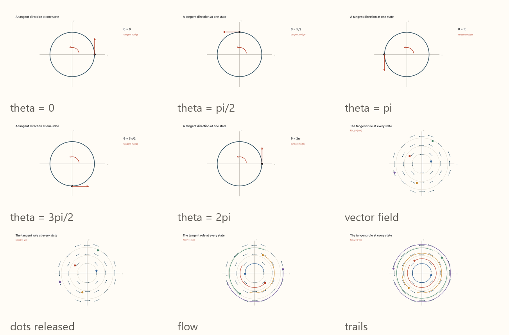

[Open MP4: symmetry-so2-vector-field-flow.mp4](animations/symmetry-so2-vector-field-flow.mp4)

*Symmetry flows provide a rich picture of symmetry transformations*

Here we ask not what happens when the transformation is applied to a single set of starting conditions, but what the transformation does to all starting conditions. Such a construction allows us to more easily see what is preserved by the symmetry.

#### Invariants and Metrics
What is the invariant of rotation in this representation? It is the length of vectors and the angles between them.

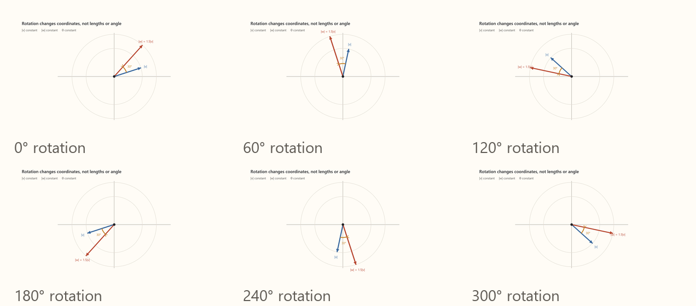

[Open MP4: symmetry-rotation-vector-invariants.mp4](animations/symmetry-rotation-vector-invariants.mp4)

*Metric structure*

These relationships are expressed by a single invariant, the dot product.

```math
\mathbf u\cdot\mathbf v
=
u_xv_x+u_yv_y.
```

An invariant of this sort, that fixes some notion of placing reliable rulers and protractors on the space, is a **metric**. For normal rotations and translations, these relationships are intuitive, but a symmetry may preserve a less intuitive metric. If we define invariant length not as \(x^2+y^2\) but as \(t^2-\mathbf{x}^2\), we have a "hyperbolic rotation." Separation between points stretches out to infinity as the rotation approaches its asymptotes, leaving the invariant interval unchanged even though the separation appears to grow using our everyday notion of distance. Such a hyperbolic metric, as we will see, encodes the asymptotic limit of light speed in the relativistic geometry **spacetime**.

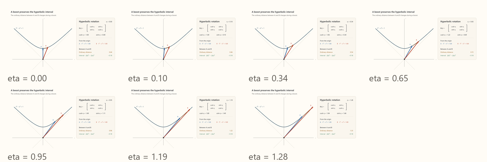

[Open MP4: symmetry-hyperbolic-rotation.mp4](animations/symmetry-hyperbolic-rotation.mp4)

*Hyperbolic rotations*

### Commutators
In the case of a single continuous symmetry transformation, the generator combined with a parameter, like angle in the case of rotation, specifies an arbitrary transformation. However, when there are multiple independent transformations that can be composed to form a closed, multi-dimensional group, the order of the composition may also need to be taken into account because it can produce different resultant states. For example, in the 3-dimensional rotation group, called $SO(3)$, rotating about the $x$-axis then the $y$-axis leaves a sphere in a different state than applying the same actions in the opposite order.

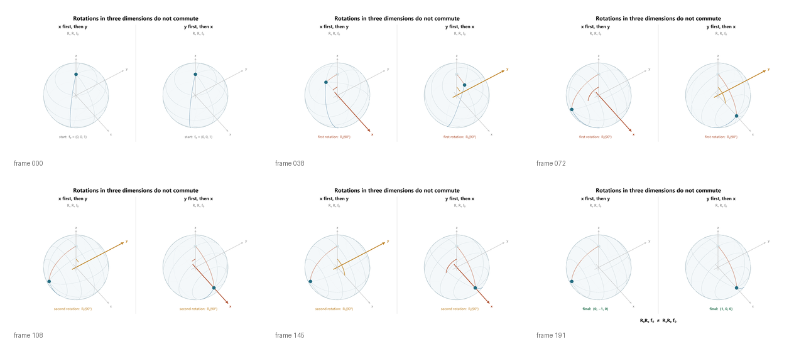

[Open MP4: symmetry-so3-rotation-order.mp4](animations/symmetry-so3-rotation-order.mp4)

*Non-commuting operations of $SO(3)$*

This order-dependence is expressed by the **commutator**:

```math
[\hat X,\hat Y]
=
\hat X\hat Y-\hat Y\hat X.
```

For example, for $\mathfrak{so}(3)$, the commutators are

```math
[\hat J_x,\hat J_y]=\hat J_z,
\qquad
[\hat J_y,\hat J_z]=\hat J_x,
\qquad
[\hat J_z,\hat J_x]=\hat J_y.
```

For small rotations about $x$ and $y$, the leading difference between the two orders points along the change generated by $\hat J_z$.

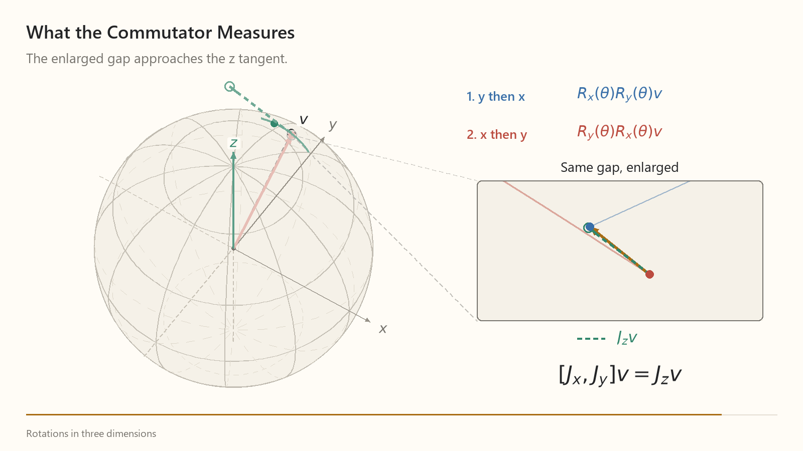

[Open MP4: symmetry-commutator-sphere.mp4](animations/symmetry-commutator-sphere.mp4)

*Shrinking the rotations reveals $\hat J_z$ in the magnified mismatch*

We can see the commutator arise from a different angle. In $SO(3)$, we know that rotating about $x$ rotates the $y$ axis into $z$. We would write such a composite action as a product of exponential maps:

```math
e^{a\hat J_x}e^{b\hat J_y}.
```

We expect to be able to write a single exponential map for the combined action of $\hat J_x$ and $\hat J_y$. For ordinary numbers, and for commuting operators,

```math
e^Ae^B=e^{A+B}.
```

But this identity does *not* hold for noncommuting generators.

```math
e^{a\hat J_x+b\hat J_y}
```

generates a rotation about a single axis in the $x$-$y$ plane, which is not the same as performing the two rotations sequentially. We can correct the exponent so that the product can again be written as a single exponential. Keeping terms through second order in the small parameters $a$ and $b$,

```math
e^{a\hat J_x}e^{b\hat J_y}
=
\exp\!\left(
a\hat J_x+b\hat J_y+\frac12ab[\hat J_x,\hat J_y]+\cdots
\right)
=
\exp\!\left(
a\hat J_x+b\hat J_y+\frac12ab\hat J_z+\cdots
\right).
```

The commutator supplies $\hat J_z$.

Moving on the surface of a sphere provides another visual intuition for noncommutativity. On a flat plane, translations in two perpendicular directions commute. On a sphere of radius $R$, we can instead move along the surface by rotating about two perpendicular axes. Near the north pole, these motions act locally like translations in $x$ and $y$. Their generators are

```math
\hat T_x=\frac{\hat J_y}{R},\qquad \hat T_y=-\frac{\hat J_x}{R},
\qquad [\hat T_x,\hat T_y]=\frac{\hat J_z}{R^2}.
```

Here $\hat J_z$ generates rotation about the pole. The factor $1/R^2$ is the sphere's curvature. For fixed small travel distances, the residual rotation from moving, then undoing the movements in the same order, shrinks as the sphere flattens.

#### Lie Algebra

Taken together, the dimension of the symmetry group and the commutators specify a **Lie algebra** that describes the group's local structure. Global features can escape that description, much as a small patch of a cylinder gives no hint that the surface wraps around. This algebra consists of the group generators, linear combinations of them, and their commutator. Every representation must preserve this commutator structure. Therefore, if we know the Lie algebra, we can use it to assess if a representation is valid.

#### Invariants and Casimir Operators

Just as symmetry transformations preserve an invariant expression built from the state, they also preserve an invariant operator built from the symmetry's generators. (A non-invariant operator would be the operator "rotate about the x-axis." If we rotate first around the y-axis, that changes the orientation of the x-axis, so the operator changes.) We can construct an invariant operator for a given irreducible representation by ensuring that it commutes with all the algebra's generators. The Casimir operator we use here rescales every vector by the same amount. In direct analogy to the invariant squared length of a vector, the invariant operator is the sum of squared rotation generators:

```math
\hat J^2=\hat J_x^2+\hat J_y^2+\hat J_z^2.
```

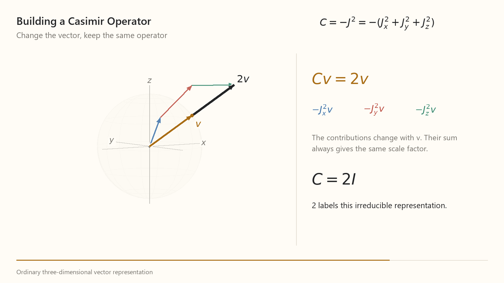

[Open MP4: symmetry-casimir-operator.mp4](animations/symmetry-casimir-operator.mp4)

*The SO(3) Casimir operator in a 3-dimensional irrep has an eigenvalue of 2*

This animation shows that the action on any vector is to rescale it by a factor of 2. 

```math
\hat C=-\hat J^2=2I.
```

An eigenvalue is the amount by which an operator scales a vector. The Casimir eigenvalue for this representation is then 2. In other irreducible representations of SO(3), the Casimir operator can take different eigenvalues. These eigenvalues label an irrep. 

In the theory we will build up to, "mass" and "spin" are examples of invariant operators derived from Casimir operators. The classification of particles (protons, electrons, etc.) is then mapped to associated labels of irreps of the full symmetry of physical evolution. We may say, if we like saying such things, "an electron is an irreducible representation of the symmetry of physical laws." Sick.

### Translations and Function Representation
Translation is, to the eye, the simplest possible symmetry. It would be natural to think the ideal representation space for a translation is simply a "sliding number line." But there is a problem. If an operation is to move $x$ by some amount $a$

```math
x\mapsto x+a,
```

then $0$ is moved to $a$, but the origin must remain fixed in a linear vector space. This is a special case of the rule for linearity. A linear operation $T$ must preserve linear combinations:

```math
T(\alpha u+\beta v)
=
\alpha T(u)+\beta T(v).
```

For translation of points on the number line, the candidate operator is

```math
T_a(x)=x+a.
```

But this does not preserve addition. For two points $x_1$ and $x_2$,

```math
T_a(x_1+x_2)
=
x_1+x_2+a,
```

while

```math
T_a(x_1)+T_a(x_2)
=
(x_1+a)+(x_2+a)
=
x_1+x_2+2a.
```

These are not equal unless $a=0$. Translation does act sensibly on a number line, but it is not a linear operation when acting on this space.


[Open MP4: symmetry-translation-point-linearity-failure.mp4](animations/symmetry-translation-point-linearity-failure.mp4)

*Shifting a number line is not a linear operation*

On the other hand, the space of functions on a number line does form a linear representation. Instead of translating the point $x$, we translate a function by shifting its argument:

```math
(T_a f)(x)=f(x-a).
```

These operators compose just as the translations do:

```math
(T_aT_b f)(x)=(T_b f)(x-a)=f(x-a-b)=(T_{a+b}f)(x).
```

Now the state is the whole function $f$, and $T_a$ is an **operator** on the vector space of functions. An operator is a generalization of a matrix when applied to continuous functions. A continuous function is an infinite-dimensional vector, in which its domain values are "axes," or component labels, and its range values are the component values. We can transform one function into another with an infinite dimensional matrix, but in practice, we can condense this into a well-known operation, such as taking the derivative. The derivative is a linear operator on the vector space of smooth functions.

Linearity works because function addition is pointwise:

```math
T_a(f+g)(x)
=
(f+g)(x-a)
=
f(x-a)+g(x-a)
=
(T_a f)(x)+(T_a g)(x).
```

So

```math
T_a(f+g)
=
T_a f+T_a g.
```

The zero function is also fixed:

```math
T_a0=0.
```

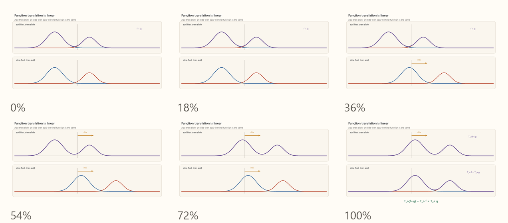

[Open MP4: symmetry-translation-function-linearity.mp4](animations/symmetry-translation-function-linearity.mp4)

*A function representation is linear*

Indeed, this representation is completely analogous to our 3 dimensional representation of $D_3$. There a vertex contained a component value, here an input value does. Indeed, the $D_3$ representation is itself a function representation, with a domain of three points.

The invariant of the function representation of translation is simply the shape of the function. Preserving that shape preserves the distances between its features, measured along the domain. The familiar distance invariant is therefore still present in this representation.

It's a good time to pause for a moment and clarify something that could cause confusion. When we say the laws of physics have certain symmetries, such as rotational or translational, we do not mean that evolution in time must preserve their elementary geometric invariants. Instead, observers related by one of these symmetry transformations agree on those invariants. Say, for example, we have a temperature field. Observers whose coordinate origins are at different points will report the same distance between two temperature peaks at a given instant. But those peaks can definitely change separation as time passes. (This takes a little care when applied to time translation itself. In that case, we compare identically prepared systems started at different times, observing each after the same amount of elapsed time.)

#### Generator of Translations
Now that we have a function representation of translation, we want to find an infinitesimal generator that acts on functions to produce a translation. We can do so by considering what happens to a function's value under infinitesimal displacements. In that case, the new value $f(x-a)$ is close to the old value $f(x)$, and the correction is given, in the limit, by the slope at $x$. This is the same idea that any curve becomes flat when zoomed in sufficiently:

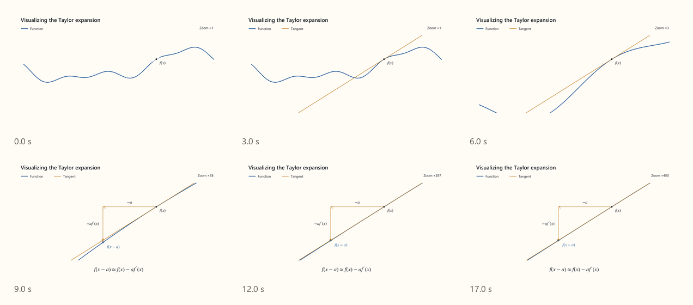

[Open MP4: symmetry-translation-tangent-zoom.mp4](animations/symmetry-translation-tangent-zoom.mp4)

*A function value is translated by the function's slope*

That is the visual version of the first-order **Taylor expansion** that relates a function's derivatives to its value under translation:

```math
f(x-a)
=
f(x)
-
a\frac{df}{dx}
+
O(a^2).
```
The translation operator is then obtained from the derivative operator through the exponential map:

```math
T_a=\exp\left(-a\frac{d}{dx}\right).
```

#### Primer — Eigenfunctions
Readers familiar with eigenvectors can [skip this primer](#eigenfunctions-of-translational-symmetry).

An **eigenvector** of an operator is a nonzero vector that the operator simply rescales. We will see that in a function representation of translation, waves are eigenvectors of translation operators and, as such, are at the center of understanding physical states. We will be well served, then, to build some intuition about eigenvectors before delving further into wave function states.

Imagine pulling on the corners of a rubber sheet whose sides are aligned with a coordinate grid's $x$ and $y$ axes. What does this action do to those axes? It rotates them toward each other while stretching them. Now, instead choose $u$ and $v$ to be diagonal axes. Now, when we stretch, the long axis is stretched but not rotated and the short axis is compressed but not rotated. The stretching action is now simply represented as scalar multiplication of the axes.

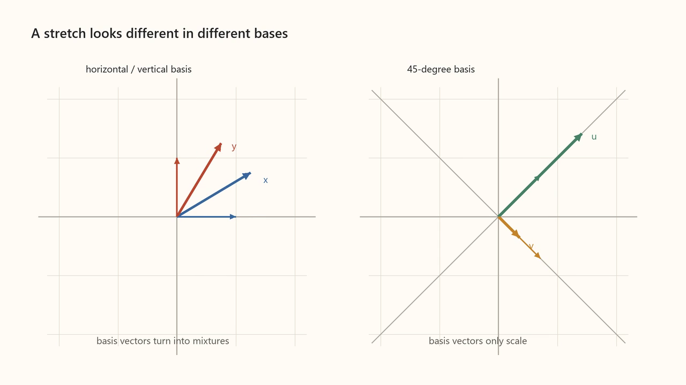

[Open MP4: symmetry-eigenbasis-comparison.mp4](animations/symmetry-eigenbasis-comparison.mp4)

*A parameterized operation scales eigenvectors*

Beyond the simplified action on eigenvectors, once basis vectors are chosen to be eigenvectors, any other vector written as a linear combination of these transforms by having its components scaled independently:

Letting $s$ be the factor by which the long-axis component is stretched, we can see how the transformation of an arbitrary vector $\mathbf{r}$ simplifies using the system's natural basis:

| $(x,y)$ basis: components mix | $(u,v)$ basis: components do not mix |
|---|---|
| $\displaystyle \begin{aligned}\mathbf r&=\frac12\begin{pmatrix}s+s^{-1}&s-s^{-1}\\s-s^{-1}&s+s^{-1}\end{pmatrix}\mathbf r_{\mathrm{in}}\\&=\frac12\left[(s+s^{-1})x+(s-s^{-1})y\right]\hat{\mathbf x}\\&\quad+\frac12\left[(s-s^{-1})x+(s+s^{-1})y\right]\hat{\mathbf y}\end{aligned}$ | $\displaystyle \begin{aligned}\mathbf r&=\begin{pmatrix}s&0\\0&s^{-1}\end{pmatrix}\mathbf r_{\mathrm{in}}\\&=su\hat{\mathbf u}+s^{-1}v\hat{\mathbf v}\end{aligned}$ |

This is readily understood visually:

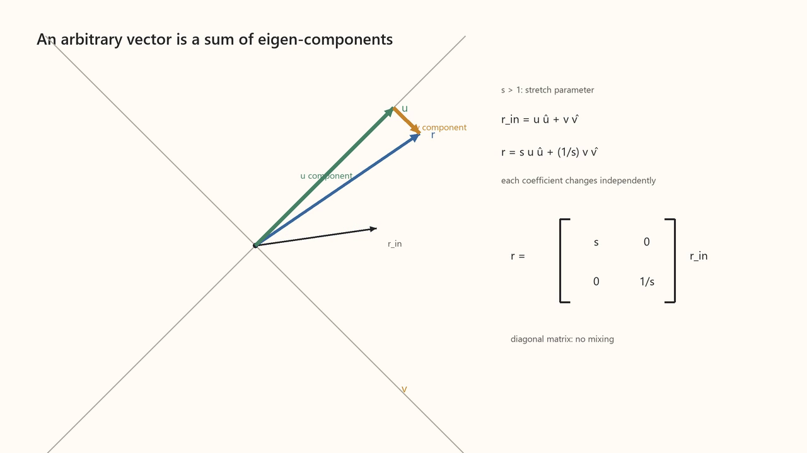

[Open MP4: symmetry-eigenbasis-components.mp4](animations/symmetry-eigenbasis-components.mp4)

*Linear combinations of eigenvectors transform under diagonal matrices*

Now for a bunch of terminology. The values an operation scales eigenvectors by are its **eigenvalues**. A basis made from eigenvectors is an **eigenbasis**. When the scaled "vectors" are functions, we tend to call them **eigenfunctions**. When our vector space is a representation and is thus thought of as a state space, we may call the eigenfunctions **eigenstates**. As the transformation matrix is diagonal in the eigenbasis, the procedure for finding an eigenbasis is typically called **diagonalization**. 

An eigenvalue equation is an equation that can be solved to find the eigenvectors and eigenvalues of an operator. It takes the form:

```math
\hat A\mathbf v=\lambda\mathbf v,
\qquad \mathbf v\ne\mathbf 0.
```

Here $\hat A$ is the operator, $\mathbf v$ is an eigenvector, and $\lambda$ is its eigenvalue.

#### Eigenfunctions of Translational Symmetry
Since a function is an infinite-dimensional vector and the generator $d/dx$ is a way of writing an infinite-dimensional matrix, we can solve a similar eigenvalue equation here, which now takes the form of a differential equation:

```math
\frac{d}{dx}f(x)
=
\lambda f(x).
```

This says we are looking for a function whose derivative returns the same function, scaled by a single number. The solution is

```math
f(x)=Ce^{\lambda x}.
```

Since

```math
\frac{d}{dx}Ce^{\lambda x}
= C\lambda e^{\lambda x},
```

the eigenvalue of $d/dx$ is $\lambda$. 

We can now take note that a finite translation of an exponential function also acts by scalar multiplication:

```math
f(x-a)=e^{-\lambda a}f(x).
```

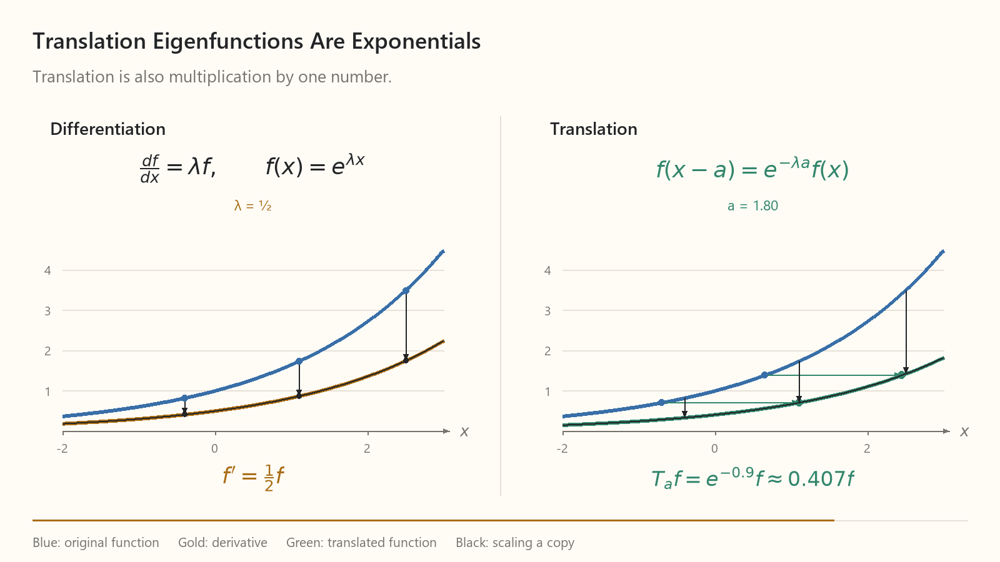

[Open MP4: symmetry-translation-eigenfunctions.mp4](animations/symmetry-translation-eigenfunctions.mp4)

*Differentiation and translation each scale an exponential*

#### Unitarity
We have determined that the eigenfunction of translation is the exponential function, but a question remains. Is the exponent real, imaginary, or complex? We will discuss imaginary numbers more below, but the bare-bones definition is

```math
i = \sqrt{-1}.
```

To resolve this, we will introduce the concept of unitary transformations. We will set the exponent question aside for a moment to explore some of the implications of unitary evolution in time. We should say that, while we are in a chapter about symmetry, in our treatment unitary evolution is not a consequence of symmetry, but follows from an additional physical principle. 

Before we go further, we need to step back and add context about where the idea of representations enters in physics. We've said that a vector in a representation space is a "state" that is acted upon by operators built from a symmetry group. In and of itself, this is a purely mathematical statement. The group we want to act on the representation space is spacetime symmetry, but we've said nothing about why physics requires a representation space up to this point. And in fact, our **classical** system of hard balls does not require a linear representation space to store state. Instead, we simply store all the positions and momenta of the system in a single, finite **phase space** vector. In quantum mechanics, as we will see, evolution must act linearly on a linear combination, or **superposition**, of states.

Thus, when we appeal to unitarity to choose our state representation, we are doing so in the context of quantum mechanics. Bearing that in mind, we can think of unitarity as being, in a way, the preservation of a principle that is self-evident in classical physics — because objects occupy definite locations, have definite velocities, and follow definite, reversible trajectories, two states of a system, two different initial preparations, remain *distinguishable* as they evolve.

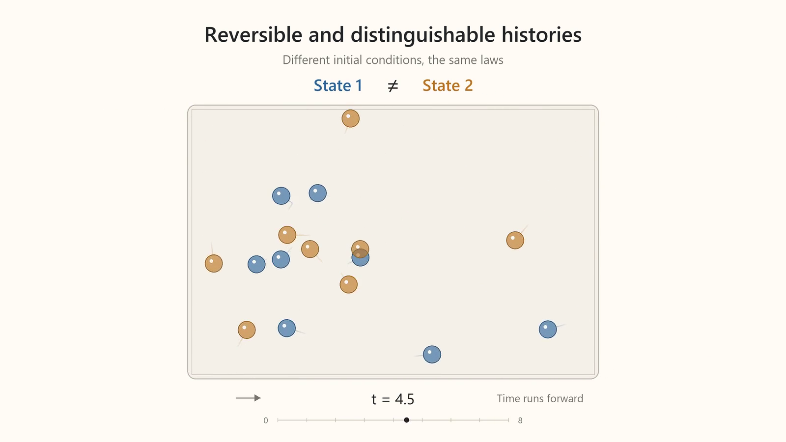

[Open MP4: symmetry-reversible-histories.mp4](animations/symmetry-reversible-histories.mp4)

*States are self-evidently distinguishable in classical physics*

In such a classical system, distinguishability is absolute. In a quantum system, distinguishability is statistical. Two states may be more or less distinguishable in the sense that the best possible measurement gives us more or less chance of correctly identifying which state was supplied. However, time evolution preserves the *degree* of distinguishability of states. Unitarity ensures this preservation, and is defined mathematically as the preservation of "overlap" or **inner product** (a generalization of the dot product) of states:

```math
\langle U\psi_1,U\psi_2\rangle
=
\langle\psi_1,\psi_2\rangle,
\qquad
\text{where }U\text{ is by definition a unitary operator.}
```

For wave functions, the overlap is $\langle\psi_1,\psi_2\rangle=\int_{-\infty}^{\infty}\overline{\psi_1(x)}\,\psi_2(x)\,dx$, where the bar denotes complex conjugation.

In the animation below, the wave states evolve unitarily, preserving their overlap.

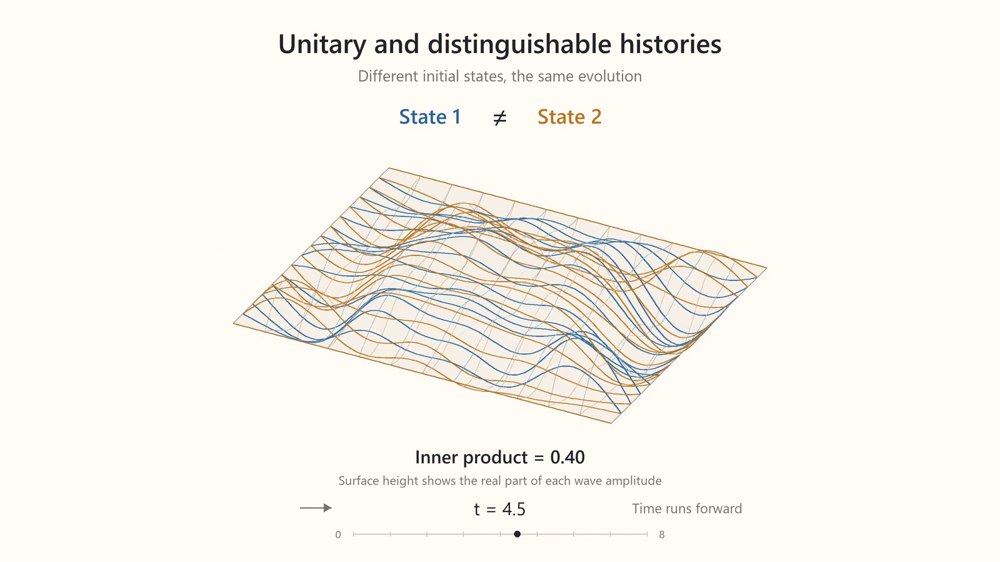

[Open MP4: symmetry-unitary-histories.mp4](animations/symmetry-unitary-histories.mp4)

*Unitary evolution preserves the overlap between states*

In addition to distinguishability, unitary evolution ensures determinism and reversibility of a state's evolution. (Note that while quantum measurements are famously non-deterministic, the state evolution, nonetheless, is. The state can evolve deterministically while giving only probabilities for where things will be found.) Setting $\psi_1=\psi_2$ in the overlap formula shows that unitary evolution preserves the integral of a function’s squared magnitude. If the function is initially normalized to one, it stays normalized. In quantum mechanics, where the squared magnitude of the wave function gives a probability density, this ensures that total probability remains one.

Let's now return to finding a suitable eigenbasis for the position translation operator. Moving the observer cannot change distinguishability, and translations likewise preserve the inner product. This requires exponential eigenfunctions to have purely imaginary exponents. Taking $U=T_a$, consider a wave packet $v$ with $\langle v,v\rangle=1$ whose translation approximately satisfies $Uv\approx\mu v$. Preservation of the inner product gives

```math
1
=\langle Uv,Uv\rangle
\approx|\mu|^2\langle v,v\rangle
=|\mu|^2.
```

As the approximation becomes arbitrarily accurate, $|\mu|=1$.

We need to add a technical caveat. Because single-\(k\) complex exponentials extend across all space without decaying, they cannot be normalized. This is not an issue in practice, as wave packets made from combinations of them are normalizable.

Translating $e^{\lambda x}$ by $a$ multiplies it by $\mu=e^{-\lambda a}$. Therefore,

```math
e^{-2a\,\operatorname{Re}\lambda}=1
\quad\text{for all }a
\quad\Longrightarrow\quad
\lambda=ik,\qquad k\in\mathbb R.
```

A more intuitive way to understand this is to visualize the multiplying factors produced by translation. For a growing or decaying real exponential, translation multiplies its coefficient by a factor that stretches or shrinks it. A unitary action on an eigenmode must instead multiply its coefficient by a factor of magnitude one. Translating a complex exponential \(e^{ikx}\) supplies exactly such a factor. It rotates the coefficient without stretching or shrinking it.

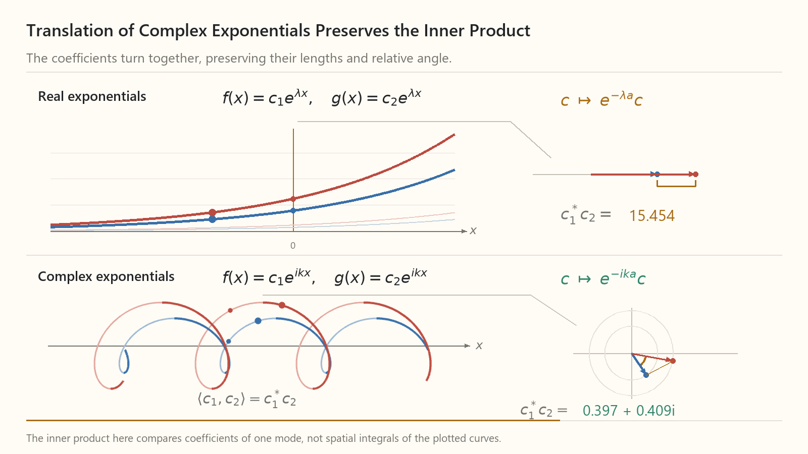

[Open MP4: symmetry-translation-unitarity.mp4](animations/symmetry-translation-unitarity.mp4)

*Two coefficients of the same complex exponential rotate together, preserving their inner product*

Since complex exponential functions are the eigenbasis for the representation space we will use for quantum states, let's spend some time gaining intuition about them. Spoiler, they are waves.

#### Primer - Complex Exponentials and Wave Packets
If you are familiar with complex exponential functions, feel free to [skip this section](#fourier-analysis).

We suggested above that the complex exponential function describes a wave. Let's explain that and generally build intuition around the complex exponential function. A single parameter complex exponential, $e^{i\theta}$, describes a circle. It is a way to repackage the rotation operator we have already seen:

```math
e^{i\theta}
\quad\longleftrightarrow\quad
e^{\theta \hat J}
=
R(\theta)
=
\begin{pmatrix}
\cos\theta & -\sin\theta\\
\sin\theta & \cos\theta
\end{pmatrix},
\qquad
\hat J
=
\begin{pmatrix}
0 & -1\\
1 & 0
\end{pmatrix}.
```

$i$ is the generator of rotation in this 1-dimensional complex representation and plays the role $\hat J$ did in the 2-dimensional representation:

```math
i^2=-1
\quad\longleftrightarrow\quad
\hat J^2
=
\begin{pmatrix}
0 & -1\\
1 & 0
\end{pmatrix}^{\!2}
=
-I.
```
How is it possible to replace a $2x2$ matrix with a single number $i$? Write the vector $(x,y)$ as a complex number $z$:

```math
z:=x+iy,
```

so $iz=-y+ix$. Multiplying by $i$ sends $(x,y)$ to $(-y,x)$, exactly as $\hat J$ does.

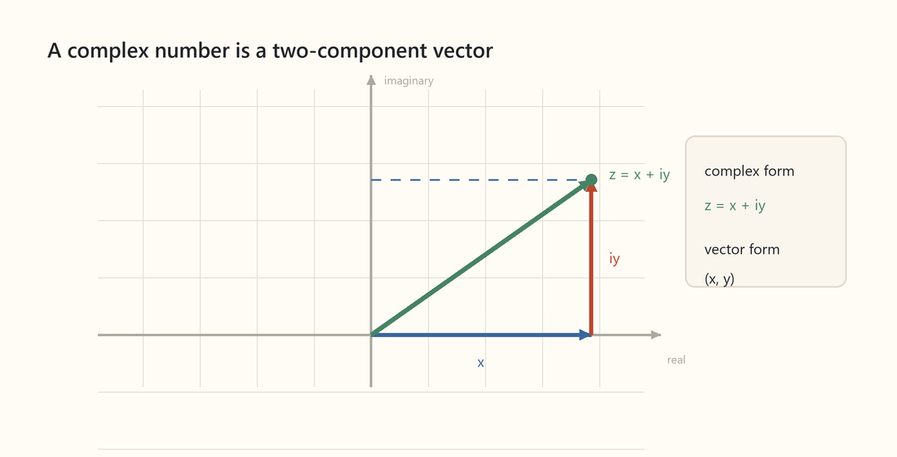

*The complex plane*

What action does multiplication by $i$ have at the identity vector $1$?

Here,

```math
\begin{aligned}
z&=1=1+0i,\\
z_{\mathrm{tan}}&=zi=1\cdot i=i=0+1i.
\end{aligned}
```

This is a vector in the complex plane that is perpendicular to the identity.

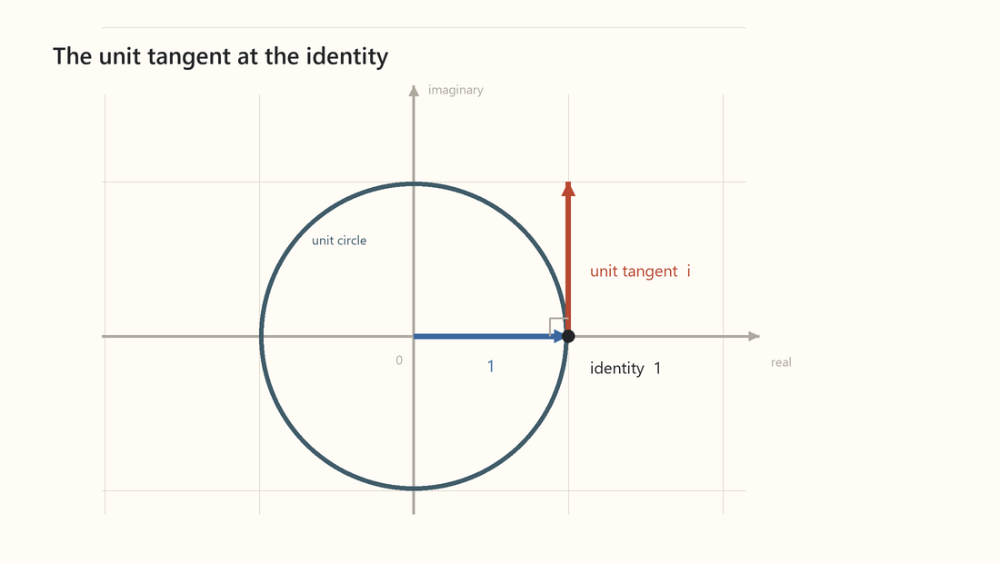

*The action of $i$*

This is exactly the action the $\hat J$ matrix generator had in 2-dimensions, which we already argued exponentiates to rotation. Let's redo that argument here, as it leads to a gratifying result. Since multiplication by $i$ produces the tangent vector at every point and the tangent vector is the geometric version of the derivative, we have

```math
\frac{dz}{d\theta}=i\,z(\theta).
```

With $z(0)=1$, solving this differential equation, we then have

```math
z(\theta)=e^{i\theta}.
```

At $\theta=\pi$, halfway around the unit circle, we then have
```math
e^{i\pi}=-1.
```

This is Euler's identity, satisfyingly relating three fundamental mathematical constants. 

We can map $z$ back to $x,y$ coordinates and obtain Euler's formula:

```math
e^{i\theta}=\cos\theta+i\sin\theta.
```

Engineers often represent real sinusoidal waves with complex exponentials using this formula and reading off the real part as multiplying exponentials is algebraically simpler than multiplying trigonometric functions.

Now let us turn from circular motion to an evolving complex wave. Let the **phase** vary with position $x$ and time $t$:

```math
\theta(x,t)=kx-\omega t,
\qquad
z(x,t)=Ae^{i(kx-\omega t)}.
```

Here $A$ is the wave's amplitude, $\lambda$ now denotes its wavelength, $k=2\pi/\lambda$ is its **wave number**, and $\omega$ sets how quickly the phase changes with time.

In the animation, position runs along the helix. The other two directions show the real and imaginary parts of the complex value at each position. As time advances, these values rotate and the wave pattern travels along $x$.

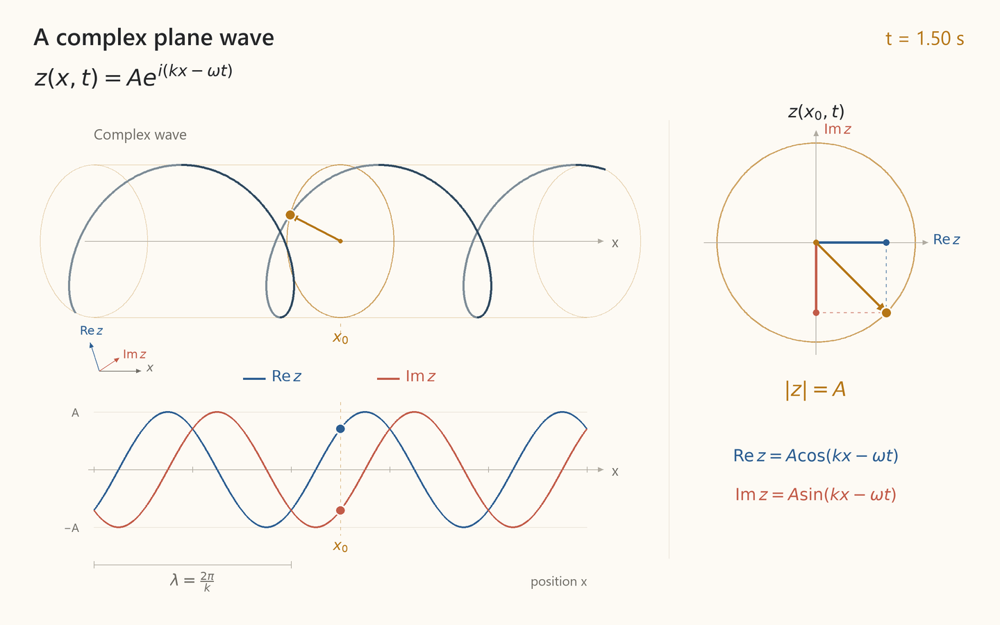

[Open MP4: symmetry-complex-plane-wave-v2.mp4](animations/symmetry-complex-plane-wave-v2.mp4)

*The complex value rotates while its length stays fixed.*

The two components are $A\cos\theta$ and $A\sin\theta$. Their values oscillate, while the length of the complex value stays fixed:

```math
|z|=\sqrt{A^2\cos^2\theta+A^2\sin^2\theta}=A.
```

Translating this wave multiplies it by a phase factor:

```math
z(x-a,t)=e^{-ika}z(x,t).
```

The eigenvalue $e^{-ika}$ has magnitude one. This is the phase-only scaling allowed by unitarity.

Earlier we wrote a rotation as $e^{\theta\hat J}$ and called $\hat J$ its generator. For translations we now use the convention $T_a=e^{-ia\hat K}$. Comparing this with $T_a=e^{-a\,d/dx}$ gives $\hat K=-i\,d/dx$. The advantage is that $\hat K$ acting on $e^{ikx}$ returns the wave number $k$ as its eigenvalue.

#### Fourier Analysis
If you strike a chord on a piano, some complicated function of time describes how the sound pressure reaches your ear. It starts soft, gets louder, softens again. It has discernible main tones, but also a clutter of overtones that comprise the timbre of the piano. While you hear a clear tonal structure, a plot of the sound pressure level over time reaching your ear would completely obscure that structure. 

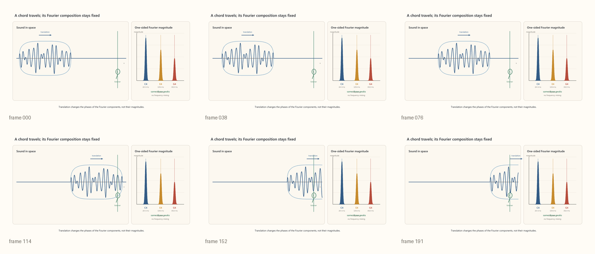

[Open MP4: symmetry-fourier-three-tone-packet.mp4](animations/symmetry-fourier-three-tone-packet.mp4)

*Fourier analysis separates a chord into its component tones*

But we know something about this random-seeming function reaching your ear. We know it is comprised of mostly 3 pitches, and some overtones. If we plot the sound pressure level as a function of these pitches rather than as a function of time, the structure of our plot clearly reveals what we hear naturally with our ear. What we call a "pitch" is the frequency of a pure **mode**. The pattern of sound pressure over time is the sum, or "composition," of these modes. We can transform back and forth between the wave number and position representations. Typically we label the wave number representation with a tilde:

```math
\psi(x)\;\longleftrightarrow\;\tilde{\psi}(k).
```

The complex coefficient $\tilde{\psi}(k)$ specifies how strongly each mode contributes and with what phase. We recover the original function by adding these contributions:

```math
\psi(x)
=
\frac{1}{\sqrt{2\pi}}
\int_{-\infty}^{\infty}
\tilde{\psi}(k)e^{ikx}\,dk.
```

The integral is a continuous sum over wave numbers. The factor $1/\sqrt{2\pi}$ fixes our normalization convention.

Because free propagation preserves the relative strengths of the wave-number components, while listeners at different distances from the piano hear the chord at different times, they agree on the tonal and timbral character.

This idea of **decomposing** a wave packet into its "Fourier modes" is remarkably general. Any function whose inner product with itself is finite can be decomposed into a linear combination, or **superposition**, of plane waves.

```math
\int_{-\infty}^{\infty}|f(x)|^2\,dx<\infty.
```

But this is not new to us. It uses the eigenfunctions we found for the function representation of translation. 

As we've mentioned before, an exact plane wave extends uniformly to infinity in the limit, so its own squared magnitude has an infinite integral. It is an ideal building block. Superpositions of these waves can nevertheless form packets with finite total squared magnitude, which we can normalize as quantum states. The transformation from an amplitude over translation coordinate to amplitude over wave number coordinate is called a **Fourier transformation**.

Quantum mechanics uses this structure to represent quantum states. Extending the quantum description to the universe as a whole, some physicists propose that the universe is a single wave function from which observations are, in a very loose manner of speaking, sampled. If we're inclined to channel our inner hippie, we might say that the complexity that unfolds in time is the dual of a single cosmic chord. Or, perhaps, as a quote attributed to Pythagoras has it: "There is geometry in the humming of the strings. There is music in the spacings of the spheres.”

## The Canonical Structure of State Space
We now understand that complex wave functions form a representation space for translations. Because translations describe changes in position, the complex wave function space provides a suitable representation space for physical evolution. A state is taken here to mean an instantaneous state, $\psi(x)$, upon which time evolution acts. Now we can ask ourselves the following startlingly fruitful questions. Do wave functions evolve into new wave functions? They better. And if they do, evolution must preserve the commutation structure of symmetry groups this space carries, for changing the wave function does not change that structure. We then ask, what implications does the preservation of this symmetry structure have for evolution? We will find that answering these questions, together with the principles that evolution must be unitary and that future states must be determined only by the current state, leads us, as a good argument can, to the abstract form of the quantum mechanical equations of motion.

### The Heisenberg Symmetry Group on State Space
Wave functions comprise our state space, that is the state at one instant. 
The Fourier duality of wave functions provides us with two paired translation operators, one in position and one in wave number. 

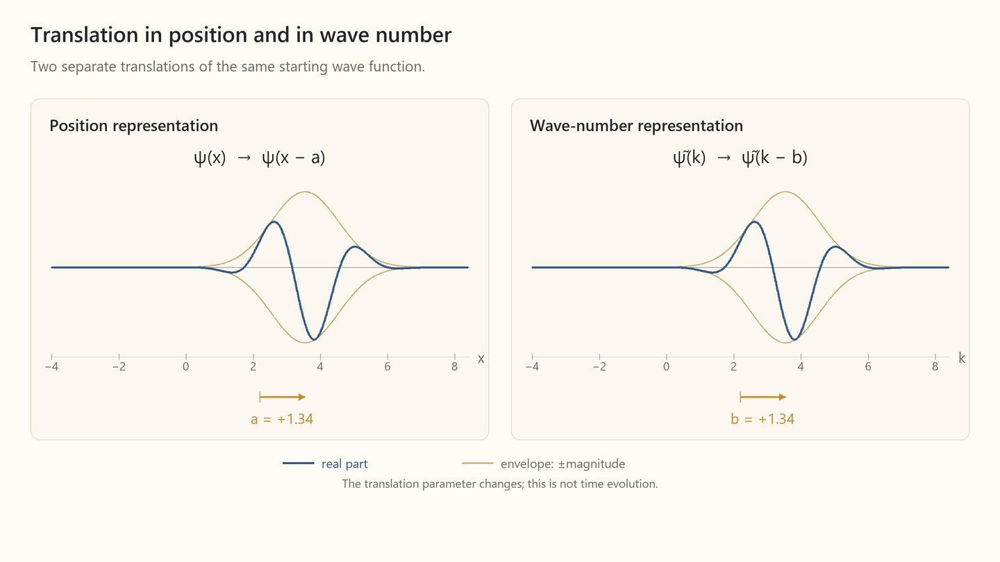

[Open MP4: symmetry-ccr-x-k-translations-symmetric.mp4](../../content/drafts/animations/symmetry-ccr-x-k-translations-symmetric.mp4)

*Wave Packet translated in position and wave number space*

Are these part of a symmetry group? To answer this, we need to first look at their commutator. We can compute the commutator directly with the generator definitions, but the more instructive route is to consider the equivalent of the commutator definition for finite translations, that is, to transport a function around a loop in $x$-$k$ space, ask how the function changes, and then shrink the loop to its infinitesimal limit. 

A position translation replaces $x$ by $x-a$. A wave-number translation shifts each mode from $k$ to $k+b$, which is done by multiplying the function by $e^{ibx}$:

```math
e^{ibx}e^{ikx}=e^{i(k+b)x}.
```

Now follow the loop:

| Action | Result |
|---|---|
| Start | $\psi(x)$ |
| Shift wave number by $b$ | $e^{ibx}\psi(x)$ |
| Shift position by $a$ | $e^{ib(x-a)}\psi(x-a)$ |
| Shift wave number by $-b$ | $e^{-iab}\psi(x-a)$ |
| Shift position by $-a$ | $e^{-iab}\psi(x)$ |

Both shifts have been undone, but the function has acquired a uniform phase of $-ab$, or $\phi$. Since phase shift is rotation in the complex plane, it “turns” the whole "spiral" of the wave function, much like a barbershop sign. For a single mode $e^{ikx}$, shifting the wave by $a$ rotates its phase by $-ka$.


*A barbershop sign illustrates a phase shift on a complex wave function*

We have learned that phase rotations in the complex plane are generated by $i$. As we shrink the loop, the gap between the loop transformation and the identity, divided by the signed area $-ab$, approaches the commutator. And because the transformation induced by travelling around the loop is a phase translation, and phase translations are generated by $iI$, we make the identification that the commutation relation is

```math
[\hat X,\hat K]
=
iI.
```

We give this a special name, the **canonical commutation relation**
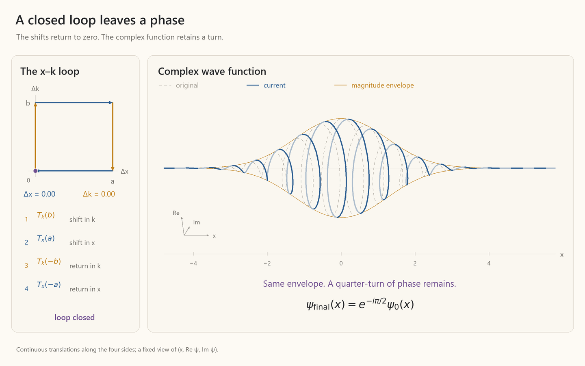

[Open MP4: symmetry-ccr-loop-complex.mp4](../../content/drafts/animations/symmetry-ccr-loop-complex.mp4)

*Phase as the $[\hat X,\hat K]$ commutator*

We can find the commutator directly from the operator definitions, but first we have to give the operator definitions. We have already given one:

```math
\hat K = -i d/dx.
```

But we have not defined $\hat X$. One definition, on account of Fourier duality, is to define $\hat X$ in the $k$-space representation:

```math
\hat X=i\frac{d}{dk}.
```

But this doesn't help us as we need to define both operators in the same representation. However, we can find the position generator directly in its own representation. We just saw that a wave-number shift is given by

```math
e^{ikx}\longrightarrow e^{i(k+b)x}=e^{ibx}e^{ikx}:
```

the translation operator is identified as

```math
(T_k(b)\psi)(x)=e^{ibx}\psi(x).
```

And since the generator is defined by $T_k(b)=e^{ib\hat X}$, expanding both sides for small $b$ gives

```math
\psi(x)+ib(\hat X\psi)(x)+\cdots
=
\psi(x)+ibx\psi(x)+\cdots.
```

Comparing the first-order terms,

```math
{(\hat X\psi)(x)=x\psi(x).}
```

The position operator in the position basis is just the wave function multiplied by the position coordinate. We can make sense of this as follows. Suppose the wave function is an idealized spike at some position that integrates to $1$ around that spike. The position operator multiplies the spike by $x$, so integrating the result yields the value of the position where the spike is.

From these definitions, we can compute the commutator.

```math
(\hat X\psi)(x)=x\psi(x),
\qquad
(\hat K\psi)(x)=-i\frac{d\psi}{dx}.
```

```math
\begin{aligned}
[\hat X,\hat K]\psi
&=\hat X(\hat K\psi)-\hat K(\hat X\psi)\\
&=-ix\frac{d\psi}{dx}
+i\frac{d}{dx}(x\psi)\\
&=-ix\frac{d\psi}{dx}
+i\psi+ix\frac{d\psi}{dx}\\
&=i\psi.
\end{aligned}
```

```math
[\hat X,\hat K]=iI.
```

The additional generator is $I$, which generates a global phase shift. 


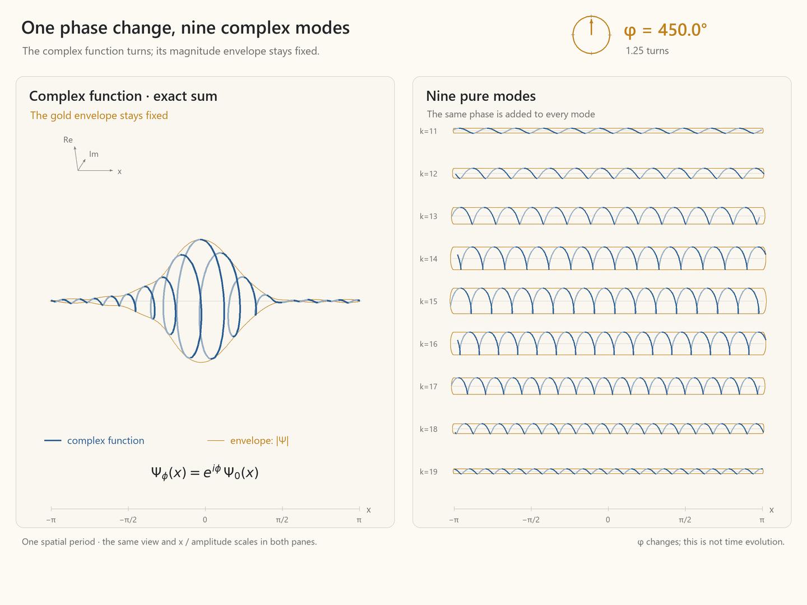

[Open MP4: symmetry-complex-phase-modes.mp4](../../content/drafts/animations/symmetry-complex-phase-modes.mp4)

*Visualizing Phase Change*

Since the phase shift generator commutes with both $\hat X$ and $\hat K$, no further generator is needed and we can conclude that $x$, $k$, and $\phi$ translations constitute a symmetry group.

```math
[\hat X,\hat K]=iI,
\qquad
[\hat X,I]=0,
\qquad
[\hat K,I]=0.
```

This group has a name, the Heisenberg-Weyl or $H_3$ group.

Here we meet a Casimir operator again. The generator of phase shifts commutes with every generator of $H_3$, and in our representation it acts as $I$, with eigenvalue $1$.

#### Preservation of the Canonical Commutation Relation
Now let us ask how these $H_3$ generators evolve. Since we require time evolution to be unitary in any case, we can take it as an assumption that the evolution operators are unitary. To make progress in our conceptual argument, we need to do a little linear algebra first. In contrast to transforming a vector by acting on the left with a matrix, we transform an operator by acting on the right with $U$ and on the left with its adjoint:

```math
\hat A_s=U(s)^\dagger \hat A\,U(s).
```

Here $\dagger$ denotes the adjoint, or conjugate transpose for matrices. For unitary $U$, the adjoint is its inverse: $U^\dagger=U^{-1}$.

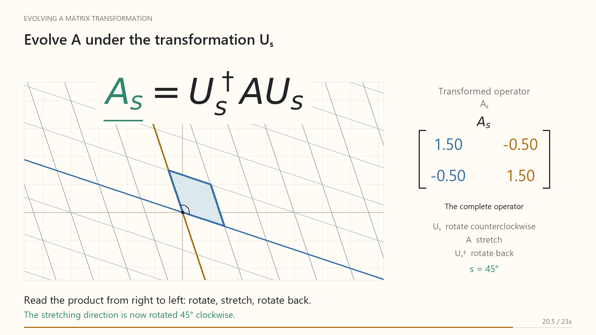

[Open MP4: symmetry-operator-sandwich.mp4](../../content/drafts/animations/symmetry-operator-sandwich.mp4)

*Transforming an operator*

Using this procedure for transforming operators, we can now show that unitary evolution (invertibility suffices with $U^{-1}$) preserves the commutator:

```math
\begin{aligned}
[\hat X_t,\hat K_t]
&=U_t^\dagger\hat X\underbrace{U_tU_t^\dagger}_{I}\hat KU_t
-U_t^\dagger\hat K\underbrace{U_tU_t^\dagger}_{I}\hat XU_t\\
&=U_t^\dagger[\hat X,\hat K]U_t\\
&=U_t^\dagger(iI)U_t\\
&=iI.
\end{aligned}
```

The evolved generators therefore obey the same commutation relation. We will use that relation below to show how each generator’s rate of change depends on how $\hat G$ varies with the other.

As an important aside, we note that, since the generator of phase shifts is preserved under unitary evolution, phase is a symmetry of the equations of motion. We can add it to position and time translation, rotation, and velocity boosts as a transformation under which equations of motion do not change.

We can see in the preservation of the commutator the geometric imprint of the result that states remain distinguishable under unitary evolution. Let us imagine evolving a patch enclosed by our $x$-$k$ parallelogram. We map a collection of states to the patch using each state's average position and wave number:

```math
\psi\longmapsto\bigl(\langle\hat X\rangle_\psi,\langle\hat K\rangle_\psi\bigr).
```

Here the angle brackets denote average values. Evolving the collection moves its representative points. This area-preserving picture holds for some kinds of unitary evolution where our map of averages is valid, with the patch undergoing simple stretches, rotations, or shears. In these cases, commutator preservation is reflected in preservation of the patch's area. Unitary evolution ensures that the members of the collection do not *merge into one another* and are thus distinguishable. Beyond distinguishability, since the area of our $x$-$k$ parallelogram must be preserved in these cases, a change in one side’s length must be balanced by a change in the other side’s perpendicular reach, through changes in length, angle, or both. In this, we see the geometric imprint of the cross-coupled generator structure inherent in Fourier duality, which we will see appear as coupling between $\hat X$ and $\hat K$ in the equations of motion.

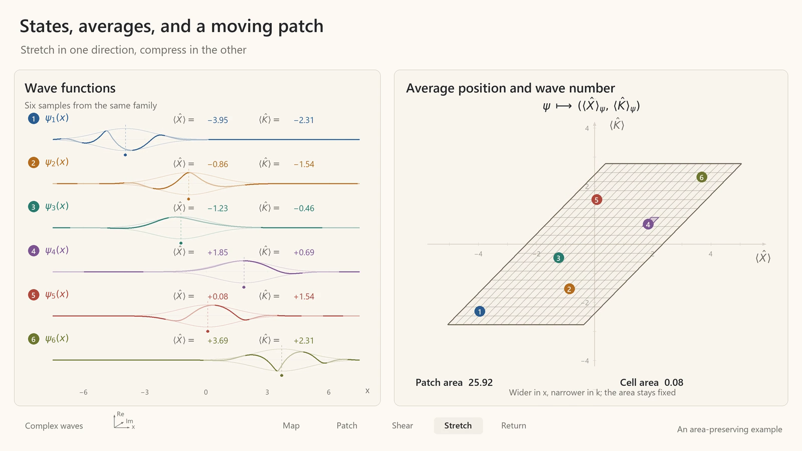

[Open MP4: symmetry-mean-patch.mp4](animations/symmetry-mean-patch.mp4)

*Distinguishability and generator coupling visualized on state space*

#### The Suitability of $H_3$ Generators for Building the Evolution Generator
Now that we have established that our state space carries the $H_3$ symmetry group and this is preserved under evolution, we can ask two questions that will allow us to ascertain how this group shapes the evolution of states. First, do the operators representing this group span the space of linear operators on our state space? Second, are its transformations unitary? If we can answer 'yes' to both of these, we will be justified in writing our time evolution generator *in terms of* $\hat X$ and $\hat K$.

We won't show that $H_3$ transformations span the operator space but will take it as a given. By way of justification, we can imagine that, just as Fourier waves form a complete set for expressing functions, position and wave-number shifts form a complete set for expressing operators on those functions. By taking weighted combinations of these transformations, we can describe a general linear operation on our state space.

We already have shown that position translations are unitary. Since wave-number space is the dual of position space, wave-number translations are also unitary. And phase shifts, which are nothing more than scalar multiplication, are unitary. In sum, the Heisenberg group's transformations are unitary, or preserve the inner product between states:

```math
\langle U\psi_1,U\psi_2\rangle
=
\langle\psi_1,\psi_2\rangle
\qquad
\text{for every symmetry action }U.
```


```math
\langle T_x(a)\psi,T_x(a)\chi\rangle
=
\langle\psi,\chi\rangle.
```

```math
\langle T_k(b)\psi,T_k(b)\chi\rangle
=
\langle\psi,\chi\rangle.
```

```math
\langle T_\phi(\beta)\psi,T_\phi(\beta)\chi\rangle
=
\langle\psi,\chi\rangle.
```

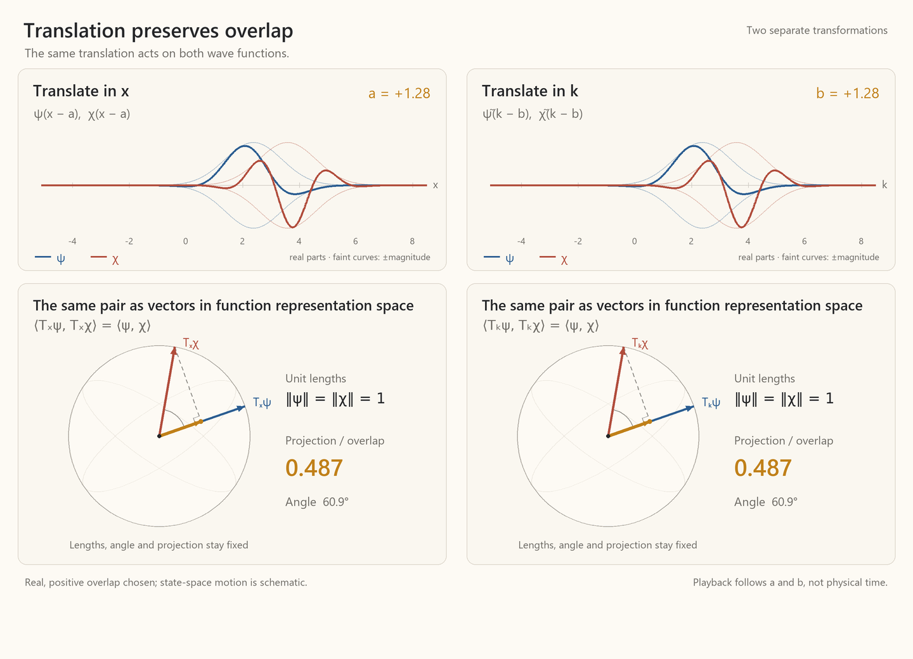

[Open MP4: symmetry-ccr-unitarity.mp4](../../content/drafts/animations/symmetry-ccr-unitarity.mp4)

*Unitarity of position and wave-number translations*

The fact that $H_3$'s transformations are unitary lends itself to using $H_3$'s generators to build the unitary time evolution operator. For example, a real linear combination of $\hat X$ and $\hat K$ generates unitary evolution. In summary, the principle that current state determines future state demands that we build the evolution operator from operators on the instantaneous state space. The completeness of the operators generated by $\hat X$ and $\hat K$ makes this possible. In position space $\hat X$ multiplies by $x$, and in wave-number space $\hat K$ multiplies by $k$. Both multipliers are real, so each operator equals its own adjoint. This is what we mean by **self-adjoint**. A self-adjoint generator $\hat G$ gives a unitary transformation because $(e^{-is\hat G})^\dagger=e^{is\hat G}=(e^{-is\hat G})^{-1}$.

#### Constructing an Evolution Operator
Knowing that time evolution preserves the structure of state space and that the evolution operator can be reasonably built from $H_3$'s generators, we can now see how remarkably much these constraints tell us about the evolution operator. 

Let's start by asking how a continuous one-parameter group of unitary transformations acts on a self-adjoint generator in our representation.

Let

- $U(s)$ be a unitary transformation,
- $\hat G$ be its generator,
- $\hat A$ be the generator of another unitary transformation.

The question we will ask is, what is the effect of $U$ on $\hat A$, expressed as a differential equation for $\hat A$. We can write a differential equation for the generator while holding the state fixed, or for the state while holding the generator fixed. These describe the same evolution, in the same sense that rotating coordinates one way is the same as rotating a vector the opposite way, or shifting a system one way is the same as shifting an observer the opposite way. The advantage of working with the evolution of the generator is that structural relations can be seen more directly than when working with state evolution, where the canonical pairing becomes explicit when we write the operators in the position or wave-number basis.

As usual, we write such a transformation as

```math
U(s)=e^{-is\hat G}.
```
and recall that

```math
\hat A_s=U(s)^\dagger \hat A\,U(s).
```
We can differentiate this expression for $\hat A_s$ using the product rule:

```math
\frac{d\hat A_s}{ds}=\frac{dU^\dagger}{ds}\hat A\,U+U^\dagger \hat A\frac{dU}{ds}.
```

Then substituting back in the definition of $U$, we arrive at

```math
\frac{d\hat A_s}{ds}=i\hat G \hat A_s-i\hat A_s\hat G=i[\hat G,\hat A_s].
```

This is a very general result that will guide our next steps, so we want to understand what it is saying. The rate of change of a generator under a unitary transformation is ($i$ times) the commutator of the transformation’s generator with it. This identity is more a kind of definition of the commutator than any unexpected discovery. The best way to understand it may be some examples. Perpendicular translations commute, so the vertical displacement generator does not change as a system flows horizontally. In contrast, the generator of 3-dimensional rotation around the $x$-axis does change as a system flows around the $z$-axis. We saw this same idea in the animation above about evolving a stretch operator under rotation. Because the operator did change, it does not commute. On the other hand, an operator that stretched in all directions does commute with rotation and doesn't change as it evolves under rotation.

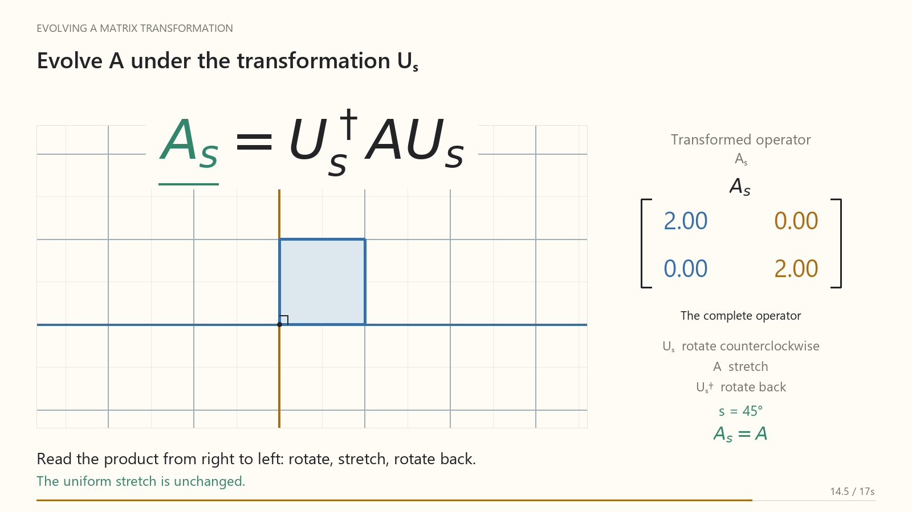

[Open MP4: symmetry-uniform-operator-sandwich.mp4](../../content/drafts/animations/symmetry-uniform-operator-sandwich.mp4)

*Uniform stretch operator is constant under rotation evolution*

Let's now adopt the terminology that $U_s$ is an "evolution" operator that is written in terms of the generators of a suitable (complete and unitary) symmetry group on the state space. With this in mind, let's rewrite $\hat G$ as

```math
\hat G = \hat G(\hat X, \hat K).
```

We then have

```math
\frac{d\hat A_s}{ds}=i[\hat G(\hat X, \hat K),\hat A_s],
```

a perfectly lifeless geometric statement. But we breathe life into it when we apply the canonical commutator:

```math
[\hat X, \hat K] = iI.
```

When we do so, we find that

```math
\frac{d\hat X_s}{ds}
=
\frac{\partial \hat G}{\partial \hat K_s}.
```

This tells us that *if we know $\hat G$*, we can say exactly how $\hat X$ and $\hat K$ evolve in time. But we have already said that weighted combinations of transformations generated by $\hat X$ and $\hat K$ can express a general linear operator on our state space. That is, if we know $\hat G$, we know the equations of motion governing our state.

Let's now show this identity 

```math
\frac{d\hat X_s}{ds}
=
i[\hat G(\hat X_s,\hat K_s),\hat X_s]
=
\frac{\partial \hat G}{\partial \hat K_s}.
```

The main idea is that, since $\hat X$ generates shifts of $\hat K$, commuting $\hat G$ with $\hat X$ measures how $\hat G$ changes when $\hat K$ shifts. The canonical relation $[\hat X,\hat K]=iI$ tells us:

```math
e^{-i\epsilon \hat X}\,\hat K\,e^{i\epsilon \hat X}
=
\hat K+\epsilon I.
```

We can apply this to the arguments to $\hat G$:

```math
e^{-i\epsilon \hat X}\,\hat G(\hat X,\hat K)\,e^{i\epsilon \hat X}
=
\hat G(\hat X,\hat K+\epsilon I).
```

Differentiate both sides with respect to $\epsilon$, at zero. As we have shown above, the left hand becomes

```math
-i\hat X\hat G+i\hat G\hat X=i[\hat G,\hat X].
```

On the right, we are changing $\hat K$ while holding $\hat X$ fixed so that

```math
\frac{\partial \hat G}{\partial \hat K}.
```

Thus, 

```math
i[\hat G,\hat X]=\frac{\partial \hat G}{\partial \hat K}.
```
Repeating the argument with the partners exchanged gives the other equation. The reversed commutator supplies the minus sign:

```math
i[\hat G,\hat K]=-\frac{\partial \hat G}{\partial \hat X}.
```

#### The Abstract Form of Wave Mechanical Equations of Motion
Now, let's shift our notation to move from an abstract evolution operator to time evolution on our Fourier state:

| Notation | Meaning |
|---|---|
| $s \to t$ | The parameter is time. |
| $U_s \to U_t$ | The operator describes time evolution. |
| $\hat G \to \hat H$ | The generator is the time evolution generator. |

With these substitutions, the two equations become


```math
\begin{aligned}
\frac{d\hat X_t}{dt}
&=i[\hat H,\hat X_t]
=\frac{\partial \hat H}{\partial \hat K_t},\\[0.5em]
\frac{d\hat K_t}{dt}
&=i[\hat H,\hat K_t]
=-\frac{\partial \hat H}{\partial \hat X_t}.
\end{aligned}
```

These equations for position and wave number have the form of the Heisenberg equations. In the quantum chapter we will connect wave number to momentum and the time evolution generator to energy. Their cross-coupled form is the operator counterpart of Hamilton's equations.

As we mentioned earlier, while the operator form of these equations leads naturally to their cross-coupled form, it obscures how the state itself evolves. Let's then take the opposing perspective and hold the operators fixed and evolve the state. Again, starting with

```math
U_t=e^{-it\hat H},
```
the evolved state is

```math
\psi_t=U_t\psi_0.
```

Differentiate the evolving state:

```math
\begin{aligned}
\frac{d\psi_t}{dt}
&=\frac{dU_t}{dt}\psi_0\\
&=-i\hat HU_t\psi_0\\
&=-i\hat H\psi_t.
\end{aligned}
```

Thus,

```math
i\frac{d\psi_t}{dt}=\hat H\psi_t.
```

The corresponding equation for the wave function has the form of the Schrödinger equation. We do not see the $\hat X$-$\hat K$ cross-coupling. But we also have not yet committed to a position or wave-number representation for the state. Once we do so, we have specific operator definitions for $\hat X$ and $\hat K$:

```math
\hat X\psi=x\psi,
\qquad \hat K\psi=-i\frac{\partial\psi}{\partial x}.
```

Consequently, writing $\hat H$ in terms of those operators gives

```math
i\frac{\partial\psi(x,t)}{\partial t}
=
\hat H\!\left(x,-i\frac{\partial}{\partial x}\right)\psi(x,t),
```

We may now ask, where is the canonical pairing between $\hat X$ and $\hat K$? The answer is that it is baked into the generator definitions. We can illustrate this by rewriting this equation in the wave-number representation:

```math
i\frac{\partial\tilde{\psi}(k,t)}{\partial t}
=
\hat H\!\left(i\frac{\partial}{\partial k},k\right)\tilde{\psi}(k,t).
```

At this point, we have said nothing about the form $H$ takes. Spoiler alert, when we connect wave functions to physical measurements in quantum mechanics, we will see that this generator is proportional to the energy operator, leading to the poetic result that "energy generates time translation." We cannot say what the functional form of $H$ is without getting further into the geometry of spacetime as elucidated by special relativity.

### Position / Wave Number Uncertainty
As we know, a single-mode wave function has a single wave number. But what position does it have? There is no way to answer this as the wave is uniform over all position space. The same statement holds in reverse. A wave packet ideally localized at one position is uniform over all $k$-space. Anywhere in between these extremes, as a wave packet is more localized in one space, its minimum possible width in the dual space increases. 

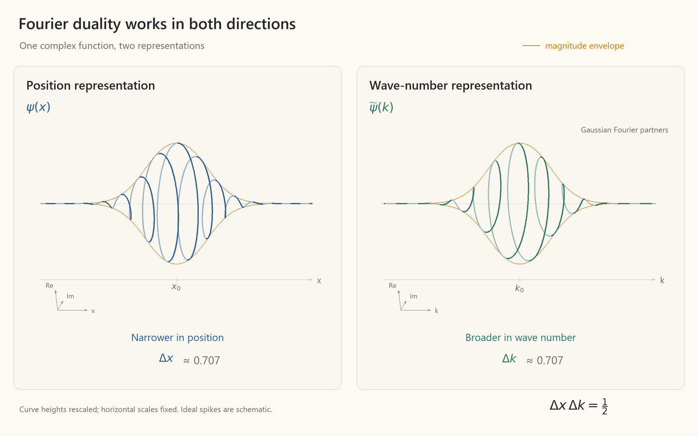

[Open MP4: symmetry-xk-fourier-complex.mp4](../../content/drafts/animations/symmetry-xk-fourier-complex.mp4)

*Trading off spread in position for spread in wave number*

We can easily see this relationship drawn on paper, but we also hear it in music. The precise pitch of a tuning fork requires long sustain, while the percussive clap of a clave has no clear pitch. This tradeoff is the root of the Heisenberg uncertainty principle, or what is known in popular science as "quantum fuzziness."

With this visual understanding of the tradeoff in the spread of the magnitude envelopes in $x$ and $k$ space, we can define the corresponding statistical standard deviation, or uncertainty, in position and wave number.

For simplicity, set the wave's mean position and wave number at their respective origins. Then

```math
(\sigma_x)^2
=
\int_{-\infty}^{\infty}x^2|\psi(x)|^2\,dx,
```

and likewise for $\sigma_k$. We also write these standard deviations as $\Delta x$ and $\Delta k$.

$\sigma^2$ is a probability-weighted average of squared distances from the distribution’s center. This is the textbook definition of variance.

From the commutation relation

```math
[\hat X,\hat K]=iI,
```

one can derive the position/wave-number "uncertainty relation":

```math
\Delta x\,\Delta k\ge\frac12.
```
This derivation is rather involved, but we can get a feel for the result by plotting the squared magnitude of a wave function and labelling the standard deviation.

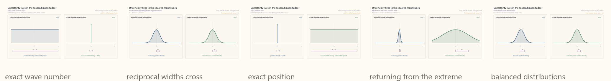

[Open MP4: symmetry-xk-squared-magnitudes.mp4](../../content/drafts/animations/symmetry-xk-squared-magnitudes.mp4)

*Trade-off in uncertainty of position and wave number*

## Looking Forward
We will turn next to using the rules of symmetry groups and our identified spacetime symmetries to propose possible geometric structures of spacetime, characterized by their invariants. This will lead to the theory of special relativity. We will then use the invariants of this geometry and the methods of variational calculus to apply the principle of least action, which supplies equations of motion for systems in spacetime. Finally, we will see how the postulates of quantum mechanics lead us to express states and their evolution in terms of symmetry representations.
