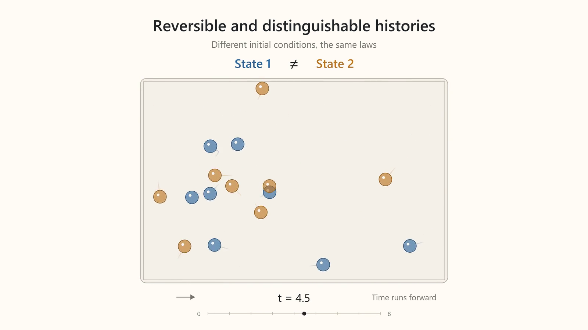
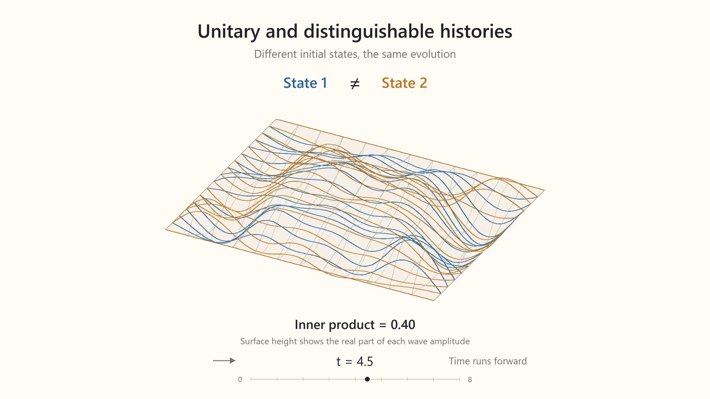
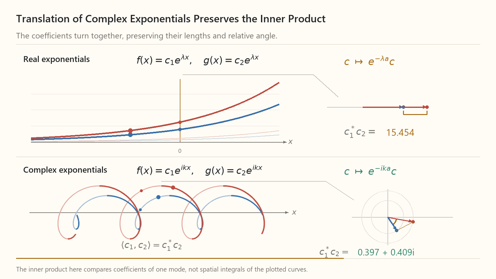

# Unitarity
We have determined that the eigenfunction of translation is the exponential function, but a question remains. Is the exponent real, imaginary, or complex? We will discuss imaginary numbers more below, but the bare-bones definition is:

```math
i = \sqrt{-1}
```

To resolve this, we will introduce the concept of unitary transformations. We will set the exponent question aside for a moment to explore some of the implications of unitary evolution in time. We should say that, while we are in a chapter about symmetry, in our treatment unitary evolution is not a consequence of symmetry, but follows from an additional physical principle. 

Before we go further, we need to step back and add context about where the idea of representations enters in physics. We've said that a vector in a representation space is a "state" that is acted upon by operators built from a symmetry group. In and of itself, this is a purely mathematical statement. The group we want to act on the representation space is spacetime symmetry, but we've said nothing about why physics requires a representation space up to this point. And in fact, our **classical** system of hard balls does not require a representation space to store state. Instead, we simply store all the positions and momenta of the system in a single, finite **phase space** vector. Symmetry representations are not required until we move from classical to quantum mechanics, where, as we will see, evolution must act linearly on a linear combination, or **superposition**, of states.

Thus, when we appeal to unitarity to choose our state representation, we are doing so in the context of quantum mechanics. Bearing that in mind, we can think of unitarity as being, in a way, the preservation of a principle that is self-evident in classical physics -- because objects occupy definite locations, have definite velocities, and follow definite, reversible trajectories, two states of a system, two different initial preparations, remain *distinguishable* as they evolve.



[Open MP4: symmetry-reversible-histories.mp4](../../content/drafts/animations/symmetry-reversible-histories.mp4)

*States are self-evidently distinguishable in classical physics*

In such a classical system, distinguishability is absolute. In a quantum system, distinguishability is statistical. Two states may be more or less distinguishable in the sense that the best possible measurement gives us more or less chance of correctly identifying which state was supplied. However, time evolution preserves the *degree* of distinguishability of states. Unitarity is this preservation, and is defined mathematically as the preservation of "overlap" or **inner product** (a generalization of the dot product) of states:

```math
\langle U\psi_1,U\psi_2\rangle
=
\langle\psi_1,\psi_2\rangle
\qquad
\text{where }U\text{ is by definition a unitary operator.}
```

In the animation below, the wave states evolve unitarily, preserving their overlap.



[Open MP4: symmetry-unitary-histories.mp4](../../content/drafts/animations/symmetry-unitary-histories.mp4)

*Unitary evolution preserves the overlap between states*

In addition to distinguishability, unitary evolution ensures determinism and reversibility of a state's evolution. (Note that while quantum measurements are famously non-deterministic, the state evolution, nonetheless, is. This can be reconciled as the state in quantum mechanics is not the location of things, but a device for predicting the probability distribution of the location of things.) Unitarity also ensures, as we will show immediately below, that the integral of a function’s squared magnitude remains unchanged. If the function is initially normalized to one, it stays normalized. In quantum mechanics, where the squared magnitude of the wave function gives a probability density, this ensures that total probability remains one.

Let's now return to finding a suitable eigenbasis for the position translation operator. Since moving the observer cannot change distinguishability, translations must likewise preserve the inner product. This requires exponential eigenfunctions to have purely imaginary exponents. Consider a wave packet $v$ with $\langle v,v\rangle=1$ whose translation approximately satisfies $Uv\approx\mu v$. Preservation of the inner product gives:

```math
1
=\langle Uv,Uv\rangle
\approx|\mu|^2\langle v,v\rangle
=|\mu|^2.
```

As the approximation becomes arbitrarily accurate, $|\mu|=1$.

We need to add a technical caveat. Because single-\(k\) complex exponentials extend across all space without decaying, they cannot be normalized. This is not an issue in practice, as wave packets made from combinations of them are normalizable.

Translating $e^{\lambda x}$ by $a$ multiplies it by $\mu=e^{-\lambda a}$. Therefore:

```math
e^{-2a\,\operatorname{Re}\lambda}=1
\quad\text{for all }a
\quad\Longrightarrow\quad
\lambda=ik,\qquad k\in\mathbb R.
```

A more intuitive way to understand this is to visualize the multiplying factors produced by translation. For a growing or decaying real exponential, translation multiplies its coefficient by a factor that stretches or shrinks it. A unitary action on an eigenmode must instead multiply its coefficient by a factor of magnitude one. Translating a complex exponential \(e^{ikx}\) supplies exactly such a factor. It rotates the coefficient without stretching or shrinking it.



[Open MP4: symmetry-translation-unitarity.mp4](../../content/drafts/animations/symmetry-translation-unitarity.mp4)

*Two coefficients of the same complex exponential rotate together, preserving their inner product*

Since complex exponential functions are the eigenbasis for the representation space we will use for quantum states, let's spend some time gaining intuition about them. Spoiler, they are, up to a lack of complete generality, waves.
